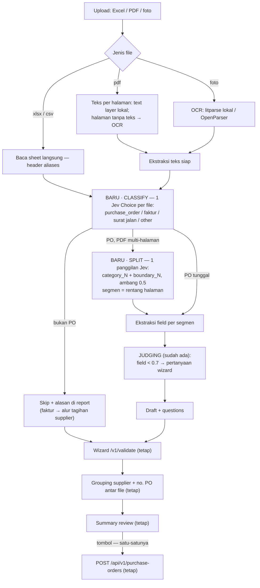

# PO Import × DocJev — plan

**STATUS 2026-09-21: B1 SHIPPED.** The ingest kernel lives in Rust
(`backend/src/cloud/intake/po/`, routes `POST/GET /api/v1/purchase-orders/import*`),
the Node service is deleted, the hub screen talks to the cloud over the same-origin
`/api`, and the wire types are generated (`make contract` → `@itulah/contract`).
Verified: 9 kernel integration tests green, live smoke through the cloud binary
(login → CSRF → multipart ingest → validate) with snake_case wire and the P0 fix
on board. B2 (Jev classify) and B3 (boundary split) remain — they need the
TypeSafe wire-format discovery pinned by a recorded contract test.

Decision: **adopt DocJev's decision logic, not its package.** DocJev is Apache-2.0 Python;
our ingest service is Node because Jev is reachable only through the AI SDK
(`server.mjs:36-39`). Porting ~150 lines of decision logic keeps one Jev call path, one
runtime, zero new services. What DocJev gives us that we lack is **triage** (what IS this
file?) and **splitting** (one scan, three POs) — both cheap Jev calls over text we already
extract.

Reference: https://github.com/jerryjliu/docjev (README, `docs/architecture.md`,
`src/jev_docs/engines/jev.py`).

---

## 1. What DocJev is (verified from the repo)

- **Classify**: one document → one category. One Jev `Choice` question over user-supplied
  rules (`categories[].id/description` + `instructions` in a YAML rules file).
- **Split**: one packet → ordered segments with page ranges. Per page: a `category_N`
  `Choice` and, for page > 1, a `boundary_N` probability question — "does page N start a
  new source document rather than continue N−1?" Boundary ≥ 0.5 opens a segment. Handles
  adjacent same-category documents (two POs back to back).
- **Engine**: LiteParse extracts page text locally (OCR included); Jev decides. Optional
  LlamaParse cloud OCR tiers for hard inputs. Whole packet normally fits ONE request;
  larger packets use 8-page windows with one output owner per page; oversized single pages
  fail visibly, text is never truncated.
- **Measured** (40-doc / 8-packet pilot, Jev 1.13.0): classification 40/40, median 138.6 ms;
  splitting 7/8 exact packets, median 209.6 ms. ~$0.012 for the whole run. GPT-5.6 baseline
  split 8/8 but 6.45× slower and ~4× the cost.
- **Hygiene worth copying**: document text is marked UNTRUSTED before going into Jev state
  (`engines/base.py`); empty OCR must pass a visual blank check before a page counts as
  blank; visibly non-blank unreadable pages fail explicitly instead of producing silent
  garbage.

## 2. What we have today (`frontend-hub/services/po-import/server.mjs`)

- Jev via AI SDK `experimental_evaluate` (`jevEvaluate`, :223) with boolean/choice/score
  questions; thresholds USABLE=0.7 / RESOLVED=0.8 (:81-82).
- PDF: text layer via pdfjs → per-page "needs OCR?" Jev decision (`decideOcrPages`, :501) —
  the doc-router pattern DocJev also cites. OCR ladder: OpenParser `/extract` first, local
  `litparse` CLI fallback, heuristics last.
- Excel/CSV read directly via header aliases (`COLUMN_ALIASES`, :545). Images = OCR only.
- Grouping ACROSS files by supplier+PO number (`groupDrafts`). **No split WITHIN a file.**
- **No triage**: every file is assumed to be a purchase document. An invoice or surat jalan
  in the upload becomes garbage lines or a failed report.
- Degraded (no `AI_GATEWAY_API_KEY`): deterministic rules, more wizard questions — honest
  and must stay that way.

## 3. Fit

| DocJev piece | Verdict | Why |
|---|---|---|
| Classify → route files | **Adopt** | One Jev `Choice` per file (~140 ms). Procurement ruleset: `purchase_order`, `supplier_invoice`, `delivery_note`, `other`. PO → draft; invoice → report says "alur tagihan supplier", no draft; other → skipped with reason. Kills the garbage-draft case. |
| Split → multi-PO scans | **Adopt** (PDFs only; images are single-page) | Per-page category + boundary questions, one request for our typical 1–10-page packets. Segments become separate drafts BEFORE `groupDrafts` — cross-file merge keeps working for multi-page-scan halves of the same PO. Biggest functional gain. |
| Rules as data | **Adapt** | Same shape as their `rules.yaml` but as JSON (`rules.procurement.json`) — no YAML dep in the service. Categories editable without code. |
| UNTRUSTED framing, blank-page check, explicit failure | **Adopt** | We feed raw OCR text into Jev state today; wrap it. A scanned blank currently yields heuristic noise. |
| 8-page windows + recursive halving | **Defer** | Our documents are small. Whole-doc one request; if Jev rejects size, fail that file visibly (their own single-page rule). Add windows only when a real packet overflows. |
| Python package / sidecar | **Skip** | Same hosted Jev, second runtime, second call path. The logic ports in an afternoon. |
| LlamaParse OCR tiers | **Skip** (revisit) | OpenParser already covers cloud OCR + schema extraction; LiteParse covers local. Third vendor = new cost path, no new capability. |
| Benchmark harness | **Skip** | Not our scope. |

Jev model note: they pin `jev-1.13.0` via typesafe_sdk; we pass `JEV_MODEL =
"typesafe-ai/jev"` through the AI SDK (:221). Keep ours; the question shapes we need
(choice, boolean-probability) are the two both interfaces document. Their `Noul` type maps
to our boolean question's probability.

## 4. Phases

### P0 — column-alias fix (ride-along, ship first) — ✅ SHIPPED 2026-09-21
`COLUMN_ALIASES.article_name` contains `"barang"`, so a `kode barang` header also maps as
`article_name` and supplier codes land in the item name (reproduced in the smoke test:
`article_name: "KLS-11"`). Fixed in `columnMap` with two-pass matching — exact alias
claims first, substring only for unclaimed fields, claimed headers never re-entered —
plus a body-filter that keeps code-only sheets importable. Verified: `kode barang,nama
barang` sheet → `article_name = "Kain Katon Prima"`; code-only sheet → 2 lines, name null.

### P1 — triage (classify)
- New `rules.procurement.json`: categories with Indonesian descriptions + instructions.
- After text extraction (any parser path), when Jev is configured: one `Choice` question
  per file over the ruleset. Result onto `PoImportFileReport`: `category`,
  `category_probability`, `review` flag (probability < 0.7, mirroring USABLE).
- Routing: `purchase_order` → drafts as today. Everything else → `status: "skipped"` with
  the category in the note ("Faktur — bukan PO; alur tagihan supplier menangani ini").
  Low-probability PO keeps the draft AND flags review.
- Degraded (no gateway key): skip the call, report `category: null`, treat as PO — today's
  behavior — and the health banner already explains what keys add.
- Screen: per-file chip in `import.tsx` UploadStep ("PO · 0.96" / "Faktur — dilewati").
**Acceptance**: mixed upload (PO pdf + invoice pdf) → one draft, one skipped-with-reason;
degraded mode unchanged output shapes.

### P2 — split (boundaries)
- For PDFs with >1 page when Jev is configured: one request with `category_N` +
  `boundary_N` (boolean) per non-blank page, whole packet at once. Boundary ≥ 0.5 → new
  segment; segment = page range.
- Extraction runs per segment (OpenParser on the page range, heuristics on the segment
  text) → one draft per segment, then `groupDrafts` as today.
- Size rejection from Jev → file fails visibly with the honest message; no truncation.
  (Windows deferred, §3.)
- Summary step already renders N draft cards; no structural screen change. Wizard per
  draft unchanged.
**Acceptance**: one PDF containing two different PO numbers → two drafts, correct
po_number/supplier per draft; single-PO PDFs unchanged; no-key mode = whole file one draft
(current behavior).

### P3 — hygiene + docs
- UNTRUSTED wrapper around all document text entering Jev state (OCR-page decisions,
  field judging, the new classify/split calls).
- Blank-page rule: OCR empty text on a scanned page → explicit per-file failure note
  instead of heuristic noise, matching DocJev's "visibly non-blank fails explicitly".
- README update: ladder diagram gains classify + split; env table unchanged.
**Acceptance**: `grep` for raw page-text interpolation in state returns only wrapped uses;
README matches behavior.

### P4 — verification (each phase, then whole)
- Service-level fixtures in `services/po-import/test/`: mixed packet (2 POs), PO+invoice
  mix, kode barang sheet, blank page, text-layer PDF.
- Degraded-mode run with keys unset: byte-comparable report shapes to today.
- E2E through the hub screen (upload → wizard → summary) with the fixtures; confirm the
  only PO-creating call remains the summary button.
- Costs: ~2 Jev calls per file (triage + split-once), medians ~140-210 ms — negligible.

## 6. Runtime fork — Node service vs port ke Rust backend (added after review)

**Kenapa Node hari ini**: `server.mjs:36-39` menuliskan alasannya — "Jev is reachable
ONLY through the AI SDK (experimental_evaluate) — the gateway's evaluation API is not an
OpenAI-compatible endpoint — which is why this pipeline is Node and not the Rust cloud."
Plus pdfjs (text layer) dan xlsx yang tinggal pakai.

**Premis itu sekarang lemah**, tiga fakta:

1. DocJev memanggil Jev yang sama dari **Python** (`typesafe_sdk.AsyncTypeSafeClient.system_one`)
   — berarti di balik AI SDK ada REST API biasa (state + questions → choices/nouls),
   bukan sesuatu yang hanya bisa dari Node. Wire format bisa dipelajari dari source
   `typesafe_sdk` dan dikunci dengan contract test atas responserekaman (CI tak butuh key).
2. Backend Rust **sudah** memanggil LLM: `cloud/http/assistant.rs` → OpenRouter
   (`OPENROUTER_API_KEY`, default base `https://openrouter.ai/api/v1`, streaming SSE) via
   reqwest. Jadi "Rust tidak memanggil model" bukan lagi benar.
3. Cargo.toml sudah memuat hampir semua yang pipeline ini butuh: `calamine` (xlsx),
   `pdf-extract` (teks PDF), `csv`, `regex`, `reqwest` (json+rustls+stream) — dan pola
   intake-nya sudah ada: `cloud/intake/` (rekening koran: imap → mail-parser → parse/pdf →
   import). PO intake adalah intake kedua, bukan yang pertama.

### Opsi

| | A — patch Node service | B — port ke Rust backend |
|---|---|---|
| Usaha | beberapa hari | B1 ~seminggu; B2–B3 menyusul |
| Runtime | dua (tetap) | satu; `frontend-hub/services/po-import/` dihapus |
| Jev | AI SDK (tetap) | modul `intake/po/jev.rs` kecil (reqwest + serde_json), key `TYPESAFE_API_KEY` langsung ke TypeSafe seperti DocJev — tanpa Vercel gateway |
| Draft | diekstrak buta di Node | bisa diresolusi server-side terhadap master `supplier`/site (wizard menawarkan record nyata) |
| Deploy | service Node terpisah | satu binary cloud |
| Risiko | minim | wire format Jev (sekali discovery, dikunci contract test); teks **per halaman** di Rust untuk split — `pdf-extract` tak beri peta halaman; mitigasi: `pdftotext -f/-l` (poppler) atau litparse, diputuskan saat B3 |

**Rekomendasi: B, bertahap.**
- **B1 — paritas tanpa Jev.** Port pipeline ke `backend/src/cloud/intake/po/`: Excel
  (calamine, port `COLUMN_ALIASES` + fix P0), PDF text layer + heuristik, foto gagal jujur
  tanpa OCR (perilaku degraded hari ini), OCR ladder OpenParser/litparse via
  `tokio::process` (identik dengan spawn Node), UNTRUSTED. Route multipart baru
  `POST /api/v1/purchase-orders/import` → `{reports, drafts}`; axum butuh feature
  `multipart`. Hub repoint proxy `/po-import` → route cloud; layar sama.
- **B2 — Jev classify.** `jev.rs` + contract test rekaman; satu Choice per file
  (`rules.procurement.json`); route non-PO; chip kategori di layar.
- **B3 — Jev split.** Teks per halaman (`pdftotext`/litparse); category_N + boundary_N;
  segmen → draft per segmen; threshold 0.5.

Setiap tahap shippable sendirian; B1 bernilai penuh meski B2–B3 tertunda (ia adalah
mode degraded hari ini, plus fix P0).

## 7. Flow baru (identik untuk A dan B — runtime tak mengubah alur)

Tanpa key Jev: classify dan split dilewati (semua file dianggap PO, tanpa split) —
perilaku hari ini; banner kesehatan tetap yang menyatakannya. Tanpa LlamaParse — tidak
pernah dipakai dan tidak akan: OCR = OpenParser (vendor lain, opsional) → LiteParse lokal
→ heuristik; penyiapan 100% lokal cukup dengan tidak men-set key OpenParser.

## 9. Unified document intake — hasil cek codebase (2026-09-21)

Pertanyaan: semua alur yang butuh upload PDF/foto/Excel, apakah satu service bisa
menangani semuanya? Jawaban singkat: **ya, satu kapabilitas — tapi sebagai modul di cloud
Rust, bukan service terpisah.**

### 9.1 Inventaris permukaan dokumen hari ini (evidence: agent://UploadSurvey, //BankRecSurvey, //ExpenseSurvey)

Tiga tier penyimpanan: bucket attachment privat `attachments/` + `documents/` (fallback
Postgres `stored_file.bytes`), bucket publik `catalogue/` + `supplier/` (gambar), dan
SQLite edge (halaman invoice DC, ≤8 MB). Tiga gaya intake: byte lewat server
(`/api/v1/files` 8 MB cap), presigned PUT (documents upload-url, gambar katalog), dan
teks/JSON di body (import bank, opening CSV, settlement report).

| Alur bisnis | Jalur dokumen hari ini | Pemrosesan | Yang hilang |
|---|---|---|---|
| Import PO | service Node dev-only (`services/po-import`) — **tidak ada di render.yaml** | classify/OCR/extract → draft | produksi; konsolidasi Rust |
| Rekening koran / rekonsiliasi | `cloud/intake/`: IMAP + dir pantau + POST manual → CSV/XLSX/PDF-TEKS(regex operator) → import 0071 | match skor (auto ≥90), `bank_rule_proposal` 0116 (manusia terima → dokumen kas), `book_bank_line` manual | **OCR** (PDF scan tak didukung), MT940/OFX, paste, **UI import di hub belum ada** |
| Expense toko (`store_expense` 0114) | foto struk via `/api/v1/files` di-attach ke claim (`store_money.rs:747-758`), DRAFT→APPROVED→POSTED, approval ≠ claimant | **foto tidak pernah dibaca** — manusia ketik kategori/amount/payee | prefill dari foto |
| Tagihan supplier (0052) | cloud tanpa lampiran; foto invoice DC hanya di SQLite edge, cloud lihat `invoice_document_ref` opaquen | tidak ada ekstraksi | bill capture terpadu (`docs/supplier-bill.md` G1–G7) |
| Settlement akuirer (0136) | teks di-paste, disimpan verbatim, parser CSV nyata (baris ditolak disimpan) | parse deterministik | jalur PDF/foto |
| Drawer documents | metadata diisi klien; kolom `processing_status/summary/tags/links` **sudah ada tapi inert** (`postgres/documents.rs:120`) | tidak ada | ekstraksi mengisi kolom itu |

Satu-satunya pipeline pemahaman dokumen yang server-side hari ini adalah `cloud/intake/`
(bank). PO import ada di Node dan mati di produksi. Tidak ada OCR/AI di mana pun.
`docs/jev-cross-domain-roadmap.md` §8 sudah mencanangkan "Document Intake" dengan
prasyarat yang persis ini dan aturan mainnya: Jev read-only, konten dokumen = data bukan
instruksi, keputusan uang tetap deterministik/manual, Jev tetap cloud-side.

### 9.2 Keputusan arsitektur

**Satu kernel intake di `backend/src/cloud/intake/doc/`, bukan service terpisah, bukan
Python, bukan paket DocJev.**

- Front door: upload yang sudah ada (`documents` drawer, `/api/v1/files`) + satu route
  multipart per alur (`/api/v1/purchase-orders/import` pertama).
- Pipeline tunggal: **teks** (pdf-extract text layer; kalau kosong/curiga → OCR litparse
  lokal / OpenParser bila key ada) → **classify** (Jev `Choice`: po / bank_statement /
  supplier_bill / expense_receipt / settlement_report / other, rules JSON per tipe) →
  **split** (boundary boolean per halaman, ambang 0.5) → **ekstraktor per tipe** (JSON
  schema + heuristik spesifik: baris PO, baris rekening koran, field struk, figure
  settlement) → **draft + pertanyaan** → manusia memutuskan lewat endpoint domain yang
  sudah ada (approve expense, accept proposal 0116, import statement, tombol summary PO).
- Jev: REST langsung ke TypeSafe (wire format dari `typesafe_sdk`, dikunci contract test
  rekaman). Tanpa key = mode deterministik hari ini, jujur di UI.
- LlamaParse: tidak pernah, tidak akan. DocJev: pola decision-nya saja (Apache-2.0,
  atribusi di NOTICE), bukan paketnya.

### 9.3 Urutan kerja (bank rekonsiliasi dulu, sesuai prioritas)

| Tahap | Isi | Kenapa urut ini |
|---|---|---|
| D1 | Kernel intake Rust: teks/Excel/classify/draft/questions + PO sebagai klien pertama; hapus service Node | klien paling kecil, memvalidasi kernel; paritas degraded hari ini + fix P0 |
| D2 | **Rekening koran**: PDF scan → baris statement draft → import 0071 + match + 0116 yang sudah ada; layar import hub (hari ini tidak ada) | **nilai tertinggi**: setengah deterministiknya sudah jadi, tinggal ekstraksi + UI; roadmap §8 mensyaratkan extraction untuk §8 intake |
| D3 | Struk → expense: ekstrak kategori/amount/payee/tanggal dari foto yang SUDAH di-attach → prefill DRAFT; approval yang ada tetap pintu satu-satunya | alur + approval sudah ada; foto tinggal dibaca |
| D4 | Bill supplier: foto invoice DC → draft bill (selaras `docs/supplier-bill.md`) | butuh keputusan model bill dulu (G1–G7) |
| D5 | Settlement akuirer: PDF → teks → parser CSV yang sudah ada | kecil, begitu kernel ada |
| D6 | Drawer documents: isi `processing_status/summary/tags` otomatis | gratis begitu kernel ada; kolomnya sudah dibuat |

Larangan roadmap tetap membatasi semuanya: Jev tidak pernah mem-posting, mencocokkan bank
match, atau menyetujui apa pun — ia mengisi draft, manusia (dan state machine) yang
berwenang.

## 10. Risks / notes

- **Jev is hosted and required for P1/P2.** Without `AI_GATEWAY_API_KEY` the feature
  silently degrades to today's behavior — the UI must keep saying so (existing banner
  pattern, `import.tsx:161-167`).
- **Probability semantics are not calibrated** (DocJev says so itself); 0.5/0.7 thresholds
  are policy starting points, same spirit as our USABLE/RESOLVED.
- **License**: Apache-2.0 — porting logic fine; keep a NOTICE line crediting DocJev for the
  boundary/threshold design.
- **OpenParser stays the extraction brain**; DocJev changes WHAT we feed it (routed,
  segmented text), not HOW we extract fields.
