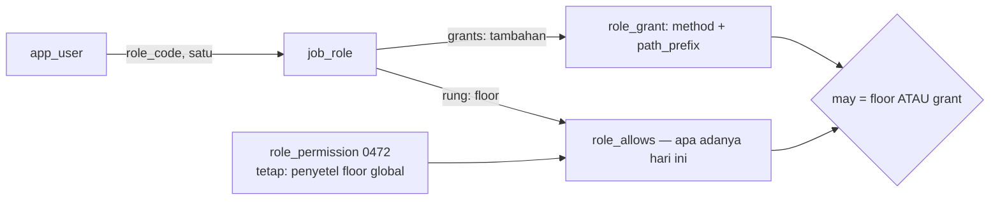

# Role dari permission set — rencana RBAC

Ditulis 2026-10-04. Status: menunggu keputusan §0, belum diimplementasi.

Pertanyaan pemilik: *permission set jadi role, gitu kan?* — ya, dan setengah
fondasinya sudah ada di repo. Temuan kuncinya: **role sebagai data sudah ada
sejak 0633** (`job_role` + CRUD `/api/v1/roles`), yang belum adalah
permission-nya sendiri — hari ini yang menjawab "boleh panggil route ini" tetap
rung `CASHIER < SUPERVISOR < ADMIN`. Plan ini memutus ikatan itu: setiap job
role membawa **permission set miliknya sendiri**, dan rung menjadi *floor*
bukan *jawaban*.

---

## 0. Keputusan yang harus dikunci pemilik sebelum fase 1

| # | Keputusan | Rekomendasi |
| --- | --- | --- |
| 0.1 | **Additive dulu, deny belakangan.** Role = rung (floor) + grant tambahan. Tidak ada baris "tolak" di v1 — role custom hanya bisa *menambah* yang boleh, tidak bisa *mencabut* bawaan rung. | Additive. Default-deny penuh menuntut mentranskripsi 28 arm `required_role` ke seed dan satu grant yang hilang = alur produksi rusak diam-diam. |
| 0.2 | **Tembok admin tidak bisa di-grant.** Grant yang menyentuh `admin_prefixes` (`domain/auth.rs:83-112`), `/roles` non-GET (`:79`), atau `/finance/permissions` ditolak server, seperti `permissions.rs:66-71` menjaga override 0472. | Ya. Tanpa ini, role rung-CASHIER bisa jadi admin user/sync lewat satu grant — kebalikan alasan tembok itu ada. |
| 0.3 | **Satu role per orang tetap.** Trigger `app_user_rung_follows_role` (`0633:164-193`) sudah mengunci `app_user.role_code` → satu baris. N:M (satu orang banyak role) bukan bagian rencana ini. | Satu role. N:M mengubah `Principal`, semua handler, dan audit; manfaatnya belum terbukti. |
| 0.4 | **Grant tidak menyeberang ke edge/store.** Node tetap berbicara tiga rung (`0635` `node_access_reconcile` menurunkan `edge_role = job_role.rung`; validasi `sync.rs:1666-1672`). Grant hanya berlaku di cloud. | Ya — ini yang membuat blast radius-nya tertahan; tidak ada perubahan sama sekali di `backend/src/edge/`. |
| 0.5 | **OWNER/ADMIN tidak bisa diberi grant.** Keduanya sudah melihat segalanya; baris grant untuk mereka cuma noise yang mengelabui editor. | Tolak dengan validation error, konsisten dengan `job_role_administrators_administer` (`0633:74-75`). |

---

## 1. Model target



- **Permission = pasangan `(method, path_prefix)`** — kosakata yang sama dengan
  0472. Tidak ada tabel katalog permission: katalognya adalah route-nya sendiri.
- **Grant = baris `role_grant` milik satu `job_role`.** Menciptakan role baru =
  buat `job_role` baru (UI-nya sudah ada, `screens/people/job-roles.tsx`) lalu
  isi grant-nya. Contoh yang hari ini mustahil: role "Finance Viewer" ber-rung
  CASHIER + grant `GET /api/v1/finance` — bisa baca buku besar tanpa bisa
  posting apa pun.
- **Semantik jawaban**: `may(user, method, path) =
  role_allows(needed_role(0472 atau required_role), rung) OR grant_match(grants)`.
  Longest-prefix menang *di antara grant*; grant tidak bisa menurunkan floor.
- **Perilaku hari-1 identik**: tabel grant kosong saat migrasi; nol grant →
  jawaban persis seperti sekarang. Tidak ada seed, tidak ada transkripsi.

## 2. Yang sudah ada (inventaris, terverifikasi)

| Permukaan | Lokasi | Peran dalam rencana |
| --- | --- | --- |
| Rung + 28 arm family route | `cloud/domain/auth.rs:14-20,62-434` | Tetap: floor. `required_role` jadi seed-generator masa depan, bukan dihapus. |
| Override floor per route (0472) | `cloud/postgres/permissions.rs`, gate di `http/auth.rs:411-418` | Tetap apa adanya — penyetel floor global. Layar Rung permissions tidak berubah. |
| Job role sebagai data | `0633` (`job_role`: rung, sections, read_only, unit_reach, flow_roles), CRUD `/api/v1/roles` (`auth.rs:79`), UI `screens/people/job-roles.tsx`, assignment di `screens/system/users.tsx:716-719`, `invite-sheet.tsx:79-90` | **Tempat grant menempel.** Editor role sudah ada; tinggal tambah panel permissions. |
| Rantai gate cloud | `require_auth` `http/auth.rs:255`; rung gate `:329` → `needed_role` `:411` → `role_allows` `domain/auth.rs:436`; section gate `:332`; reach per-handler (`scope.rs:55-66`, `reach.rs:219-226`) | Satu-satunya tempat evaluasi diubah: langkah `:329`. |
| Edge + store | `edge/auth.rs:118-146` (`EdgePermission::minimum_role`), proyeksi `edge/sync.rs:2039-2157`, `0635` | **Tidak disentuh.** Rung tetap satu-satunya yang menyeberang (keputusan 0.4). |
| Kontrak | `backend/src/contract.rs:19-31` (wire Role), ts-rs via `make contract` (`Makefile:59-61`) | Tambah tipe `RoleGrant`; `Role` union tidak berubah. |
| Hub literal rung | 24 file (daftar lengkap di riset; runtime yang bermakna: `lib/apps.ts:96,101`, `lib/session.tsx:103`, 4 picker) | Tidak diubah di v1 — shell menu tetap rung. Gating by grant (`officeFor` → capability) sengaja di luar lingkup. |

## 3. Migrasi `0830_a_role_carries_its_own_permissions.sql`

```sql
CREATE TABLE role_grant (
    role_code   text NOT NULL REFERENCES job_role(code) ON DELETE CASCADE,
    method      text NOT NULL CHECK (method IN ('*', 'GET', 'POST', 'PUT', 'PATCH', 'DELETE')),
    path_prefix text NOT NULL CHECK (path_prefix LIKE '/api/%'),
    note        text,
    set_by      text NOT NULL CHECK (btrim(set_by) <> ''),
    set_at      timestamptz NOT NULL DEFAULT now(),
    PRIMARY KEY (role_code, method, path_prefix)
);
```

- Copy bentuk `role_permission` (0472) — PK ganda membuat upsert idempoten.
- Tanpa seed. Tanpa perubahan kolom lain. Edge (sqlite) tidak dapat migrasi ini.
- `ON DELETE CASCADE` mengikuti masa hidup job role — hapus role (sudah bisa,
  `deleteRole` di `lib/queries/invitations.ts:150-177`) ikut menghapus grant-nya.

## 4. Backend cloud

**Domain** — `cloud/domain/role_grant.rs` baru (atau bersama `job_role.rs`):

```rust
/// Satu izin tambahan sebuah job role: method dan prefix path yang boleh
/// dipanggil pemegang role itu di atas rung-nya.
pub struct Grant { pub method: String, pub path_prefix: String }

pub fn grant_allows(grants: &[Grant], method: &str, path: &str) -> bool {
    grants.iter().any(|g|
        (g.method == "*" || g.method.eq_ignore_ascii_case(method))
            && path.starts_with(&g.path_prefix))
}

/// Tembok admin (keputusan 0.2): path yang tidak boleh di-grant.
pub fn grantable(path_prefix: &str, method: &str) -> Result<(), String> { /* admin_prefixes, /roles non-GET, /finance/permissions */ }
```

**Sesi membawa grant** — `JobGrant` (`cloud/domain/job_role.rs:85-160`) ditambah
`grants: Vec<Grant>`, diisi di `postgres/users.rs` (`authenticate_session:300-353`
sudah JOIN `job_role`; satu query anak per sesi, atau cache 30 dtk per `role_code`
meniru pola `PERMISSION_CACHE` di `http/auth.rs:382-408`).

**Gate** — satu titik, `http/auth.rs:329`:

```rust
// sebelum:
gate_role_with(&method, &path, role, &permission_overrides(&state).await)?;
// sesudah:
if gate_role_with(&method, &path, role, &permission_overrides(&state).await).is_err() {
    if !grant_allows(&job.grants, &method, &path) { return Err(Forbidden(..)); }
}
```

- Catatan kegagalan menyebut sumber: "requires SUPERVISOR, and no grant of
  your role covers it" — satu kalimat, bukan dua sistem.
- `gate_allows` (`:439-441`) — pembaca jawaban untuk layar (assistant path gate)
  — diubah dengan arti yang sama.
- **Relayed call** (`:260-273`) tetap rung saja: panggilan node → cloud adalah
  infrastruktur sync/system, bukan manusia memegang role; principal relayed
  tidak membawa `role_code` (`auth_policy.rs:135-142`).
- Delegation (0812, `:317-327`) otomatis benar: ia mengganti `(role, job)` —
  grant mengikuti job yang dipinjam.

**HTTP** — di samping route `/api/v1/roles` yang ada:

```
GET    /api/v1/roles/{code}/grants                       → RoleGrant[]
PUT    /api/v1/roles/{code}/grants   { method, path_prefix, note? } → RoleGrant[]
DELETE /api/v1/roles/{code}/grants?method=&path_prefix=  → RoleGrant[]
POST   /api/v1/roles/{code}/effective { method, path }   → { allowed, source: "RUNG"|"OVERRIDE_0472"|"GRANT"|"SECTION"|"REACH", detail }
```

- Semua route di bawah tembok `/roles` non-GET → ADMIN (`auth.rs:79`), jadi
  pengelolaan grant otomatis se-kuat pengelolaan role — tidak butuh aturan baru.
- `effective` adalah fungsi murni yang sama dengan gate, diekspos agar editor di
  hub bisa menunjukkan "route ini boleh karena X" tanpa menebak.

**Penulisan** — `postgres/role_grants.rs`, cermin `permissions.rs`: validasi
`grantable()` (0.2, 0.5) di sisi Rust, tulis, kembalikan daftar. Audit log row
seperti yang permissions.rs lakukan.

## 5. Kontrak dan hub

- `backend/src/contract.rs`: tambah `RoleGrant` + `EffectiveAnswer` dengan
  `#[cfg_attr(feature = "ts", ...)]`, jalankan `make contract`
  (`Makefile:59-61`); `contract-check` (`:73-83`) menjaga drift.
- `lib/queries/invitations.ts` (tempat `useRoles`/`updateRole`/`deleteRole`,
  `:150-177`): tambah `listGrants(code)`, `putGrant(code, g)`, `removeGrant(code, key)`,
  `testEffective(code, method, path)`.
- `screens/people/job-roles.tsx`: panel **Permissions** pada sheet role —
  daftar grant (Method / Prefix / Note / Set), form tambah (sama seperti form
  di `permissions.tsx:170-218`, tanpa pilih role karena role sudah dipilih),
  tombol hapus, dan baris **"Coba route"**: method + path → `effective` →
  pill `allowed` + sumber jawaban.
- `screens/finance/permissions.tsx` **tidak disentuh** — dia penyetel floor
  (0472), beda fungsi dengan panel per-role ini. Sub-judul kedua layar
  saling menjelaskan: "floor semua role" vs "tambahan satu role".

## 6. Yang sengaja di luar lingkup v1

- Baris deny (mencabut bawaan rung) — menunggu 0.1 terbukti kurang.
- Default-deny penuh + katalog permission eksplisit.
- N:M user↔role (0.3).
- Grant di edge/store, dan proyeksi grant ke `auth policy` (0.4).
- Gating UI shell by capability (`officeFor`/`systemFor`, `lib/apps.ts:95-102`)
  → tetap rung. Layar bisa lebih tajam belakangan dengan `effective`.
- Layar "katalog semua route × siapa boleh" (bisa dibangun di atas `effective`
  dengan sampling `required_role`, tapi bukan sekarang).

## 7. Uji dan penerimaan

Integrasi dulu (`backend/tests/role_grants.rs`, pola `edge_cloud_sync_integration.rs`),
E2E kemudian lewat Portless (`pl-start` → `e2e`):

| # | Kasus | Penerimaan |
| --- | --- | --- |
| 1 | Paritas hari-1 | Tanpa grant: 200/403 identik dengan main untuk sampel route lintas 28 arm (termasuk arm 1, 9, 26, 28 — tepi tabel). |
| 2 | Grant menambah | Role rung-CASHIER + `GET /api/v1/finance` → GET finance 200, POST finance tetap 403. |
| 3 | Override 0472 tetap menang di floor-nya | Override `GET /api/v1/x → ADMIN` tidak bisa diturunkan grant CASHIER (grant menambah, tidak mengurangi). |
| 4 | Tembok admin (0.2) | `PUT grant` ke `/api/v1/auth/users` → 422; ke `/api/v1/roles` POST → 422; `/finance/permissions` → 422. |
| 5 | OWNER/ADMIN (0.5) | `PUT grant` role OWNER → 422. |
| 6 | Grant mengikuti role | Hapus job role → grant-nya hilang (CASCADE); ganti `role_code` user → jawaban `effective` ikut role baru. |
| 7 | Section gate & reach tidak berubah | Role dengan grant finance tapi `sections` tanpa `finance` → tetap 403 dari section gate (`auth.rs:332`), pesannya benar. |
| 8 | Relayed & flow | Panggilan relayed node diabaikan grant-nya; `Actor::holds` dan stage flow tidak terpengaruh. |
| 9 | E2E hub | Buka People › Job roles › satu role: tambah grant, tombol "Coba route" berubah 403 → 200 di sesi user pemegang role itu; hapus grant → kembali 403. |

Kontrak: `make contract` tanpa diff tertinggal; `cargo test`; hub
`npm run typecheck && npm run lint && npm run design-lint` — semua hijau di
akhir tiap fase.

## 8. Urutan fase

1. **Fase 1 — domain + migrasi** (`0830`, `Grant`, `grant_allows`, `grantable`) + uji kasus 1, 4, 5 di level unit domain. Titik cek: `cargo test`.
2. **Fase 2 — sesi + gate** (`JobGrant.grants`, `http/auth.rs:329`, `gate_allows`, cache) + uji 1–3, 6–8. Titik cek: `cargo test`.
3. **Fase 3 — HTTP + kontrak** (route grants/effective, `make contract`). Titik cek: `cargo test` + `contract-check`.
4. **Fase 4 — hub** (queries + panel Permissions + Coba route). Titik cek: typecheck/lint/design-lint.
5. **Fase 5 — uji kasus 9** E2E lewat Portless, lalu rapikan doc (`permissions.rs` modul doc, `domain/auth.rs` doc dapat paragraf "grants"), hapus skrip throwaway.

Setiap titik cek adalah gerbang fase berikut, bukan jeda.
