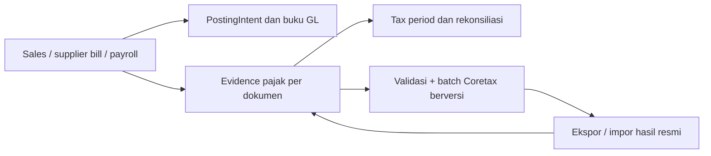

# Riset ERPNext, Finance kita, dan lokalisasi pajak Indonesia

**Tanggal riset:** 23 September 2026  
**Tujuan:** membandingkan model Finance kita dengan ERPNext dan dua implementasi lokalisasi Indonesia; menentukan ide yang berguna untuk diadopsi tanpa menambah penulis buku atau memindahkan arsitektur aplikasi.  
**Kesimpulan singkat:** fondasi akuntansi kita sudah mengikuti banyak pola ERPNext. Kesenjangan yang paling bernilai sekarang ada pada **operasi kepatuhan Indonesia**: bukti faktur pajak, pertukaran file Coretax, status hasil/reject, PPN masukan, dan bukti potong. Ambil alur dan kontrolnya; jangan memasang app Frappe atau menyalin kodenya langsung ke backend Rust.

## Cakupan dan cara membaca hasil

Saya membaca kode dan dokumentasi lokal, membandingkan file kedua repo lokalisasi, dan memeriksa dokumentasi ERPNext serta halaman resmi DJP. Ini adalah audit statis pada checkout yang tersedia; saya tidak menjalankan ERPNext, menguji API eksternal, menjalankan suite test, atau menyatakan aturan pajak ini sebagai validasi legal.

Workspace Finance sedang memiliki banyak perubahan yang belum dikomit. Migrasi 0299–0317 dan fitur yang menyertainya ada di working tree sekarang, tetapi status keberadaannya di sini **tidak membuktikan bahwa semua migrasi sudah diterapkan ke setiap database atau fitur sudah dirilis**. Dokumen lama [`erpnext-finance-adoption.md`](erpnext-finance-adoption.md) dan [`FINANCE-ARCH-PLAN.md`](../FINANCE-ARCH-PLAN.md) merekam rencana/status per 22 September; bagian yang masih berstatus “belum” perlu dibandingkan dengan isi working tree 23 September ini.

## Snapshot sumber

| Sumber | Checkout yang ditelaah | Isi penting |
|---|---|---|
| ERPNext upstream | `develop`, `3c251254b8ff4ffa90d565045c43f64c8e78fe45`, 21 Sep 2026; `__version__ = 17.0.0-dev` | Finance bawaan ERP berbasis Frappe; GPL-3.0 |
| `agile-technica/erpnext-indonesia-localization` | `develop`, `82d5be9`, 19 Jun 2026; merge release v1.4.1 | Implementasi Coretax/e-Faktur yang lebih baru; AGPL-3.0; deklarasi Frappe 14–16 |
| `andrimuhyidin/erpnext-indonesia-localization` | `develop`, `1f9702b`, 29 Jan 2026; README menyebut v1.2.0; tidak ada tag rilis pada clone | Cabang yang berbeda dengan API Pajak.io, VAT input/output, e-Bupot, dan cakupan ekstra; AGPL-3.0 |
| Finance workspace ini | branch `feat/handheld-rfid`, working tree aktif | Rust + Postgres + kontrak TypeScript; migrasi lokal sampai 0317; ada perubahan belum dikomit |

Dua repo lokalisasi sudah tersedia sebagai clone penuh di [`research/erpnext-indonesia/`](../research/erpnext-indonesia/README.md), dengan riwayat dan tag di-fetch setelah clone awal. ERPNext utama sudah tersedia di `../erpnext` sebagai clone shallow karena checkout ERPNext jauh lebih besar. Tidak ada source repo yang saya ubah.

## 1. Model Finance ERPNext

ERPNext bukan satu form jurnal dengan banyak tombol. Pola intinya memisahkan **dokumen bisnis**, **General Ledger**, **Payment Ledger**, dan **aktivitas bank**:

| Lapisan | Pertanyaan yang dijawab | Contoh ERPNext |
|---|---|---|
| Dokumen bisnis | Peristiwa apa yang terjadi? | Sales/Purchase Invoice, Payment Entry, Journal Entry, stock/asset/payroll document |
| General Ledger | Akun mana yang didebit/dikredit? | GL Entry; baris membawa akun, pihak dan dimensi |
| Payment Ledger | Pembayaran/kredit mana yang melunasi invoice mana? | Payment Ledger Entry dan Payment Reconciliation |
| Bank | Apa yang muncul di rekening koran, dan apakah cocok dengan buku? | Bank Transaction, import/sync dan Bank Reconciliation |
| Kepatuhan negara | Bagaimana bukti transaksi memenuhi format/regulasi negara? | regional app terpisah, seperti lokalisasi Indonesia |

Dokumentasi resminya menegaskan bahwa impor Bank Transaction sendiri tidak memposting GL; posting berasal dari voucher. Rekonsiliasi bank mencocokkan fakta statement dengan voucher, sedangkan Payment Reconciliation mengalokasikan pembayaran yang sudah tercatat ke invoice dan tidak memindahkan uang lagi. Pemisahan ini sangat berguna untuk mencegah rekonsiliasi bank bercampur dengan penyelesaian utang/piutang. [Accounting Introduction](https://docs.frappe.io/erpnext/accounting-introduction), [Banking](https://docs.frappe.io/erpnext/banking-in-erpnext), [Payment Ledger](https://docs.frappe.io/erpnext/payment_ledger), [Payment Reconciliation](https://docs.frappe.io/erpnext/payment-reconciliation)

Pola lain yang layak dibandingkan adalah:

- `Party Type` mengatur kosakata party; `party_type`/party pada GL memberi cara untuk mengelompokkan saldo kontrol dan menelusuri pihak.
- `Party Account` mengikat pihak ke akun default dan memecahkan akun secara bertingkat; akun yang tidak ditemukan seharusnya menimbulkan error konfigurasi, bukan tebakan.
- Payment Ledger mempertahankan hubungan invoice, kredit, pembayaran, uang muka dan alokasi tanpa menggandakan posting kas.
- Bank Transaction menyimpan fakta baris bank secara terpisah dari voucher; rekonsiliasi memberi kandidat, alokasi parsial, biaya dan transfer antar rekening.
- Budget, Account Category/dimensi, close period, deferred accounting, aset, tax templates, dan laporan AP/AR/GL/TB/P&L melengkapi siklus harian.

ERPNext adalah ERP luas: menu Accounting berdekatan dengan invoicing, purchasing, inventory, payroll dan assets. Karena semua itu hidup dalam Frappe dan saling memanggil, jumlah doctype/menu yang tampak bukan ukuran yang tepat untuk kebutuhan Finance kita. Ambil batas tanggung jawab datanya dan alur akuntansinya, bukan keseluruhan permukaan produk. Repo upstream menyebut Accounting, order management, manufacturing, assets, dan projects sebagai fitur utama. [ERPNext GitHub](https://github.com/frappe/erpnext)

## 2. Dua repo lokalisasi Indonesia

Keduanya adalah app untuk ERPNext/Frappe, bukan library pajak netral yang bisa langsung dipakai oleh aplikasi Rust. App memasang custom field, doctype, hook/event handler, workspace, dan sejumlah integrasi di lifecycle Sales/Purchase Invoice. Kedua LICENSE yang ada di clone adalah AGPL-3.0.

| Aspek | Agile Technica (`82d5be9`) | Andri Muhyidin (`1f9702b`) |
|---|---|---|
| Kesegaran snapshot | Lebih baru; merge release v1.4.1 pada Jun 2026 | Commit terakhir yang ter-clone Jan 2026; README masih menyebut v1.2.0 |
| Kecocokan ERPNext | `pyproject.toml` mendeklarasikan Frappe `>=14,<17`; manual dan test menunjukkan target v15/v16 | README menyebut ERPNext v15/v16; metadata tidak memberi batas Frappe yang setara |
| Jalur Coretax | XML exporter dengan preview/validasi, importer hasil DJP, metadata VAT keluaran, nomor faktur, kode transaksi/fasilitas/unit/barang-jasa, referensi master, manual dan test | Memuat jalur Coretax serupa, serta doctype dan utility tambahan |
| Fitur pajak ekstra yang terlihat di kode | Lebih ramping; README menonjolkan Coretax XML export/import | API Pajak.io untuk VAT output/input, PPh withholding/e-Bupot, return, verifikasi NPWP/NIK, audit/status/report, bulk operation, dan data VAT masukan |
| Dokumentasi | Manual Indonesia/Inggris, panduan install dan manual Coretax | Developer/API/troubleshooting/security docs dan improvement plan; beberapa dokumen bertanggal Jan 2026 |
| Ukuran snapshot (indikatif) | sekitar 152 file repo; 67 Python; 17 file test-like | sekitar 270 file repo; 135 Python; 22 file test-like |

Riwayat Git kedua repo berbagi 281 commit; titik temu terakhir adalah merge v1.2.0 Agile Technica pada 13 Nov 2025. Repo Andri lalu bergerak pada branch sendiri, sementara Agile merilis sampai v1.4.1 pada Jun 2026. Jadi Andri bukan implementasi independen dari awal, tetapi cabang lebih tua yang kemudian memperluas/menata ulang fitur. Angka file bukan ukuran coverage atau jaminan mutu. Tidak ada tes yang dijalankan dalam riset ini. Repo Andri mempunyai catatan security review sendiri yang menyebut operasi hapus permanen dan merekomendasikan kontrol tambahan; dokumen itu adalah temuan internal repo, bukan audit independen. Jumlah whitelist yang dilaporkan dokumen internalnya berbeda-beda: security review meringkas 53, improvement plan menyebut 85, sedangkan scan kode clone ini menemukan 89 deklarasi. Itu perlu audit ulang sebelum pemakaian.

### Mana yang lebih berguna untuk kita?

- **Agile Technica adalah referensi utama untuk alur Coretax terkini yang bisa kita telusuri**: export batch, preview/validasi, master reference, import hasil resmi, status dan dokumentasi pemakai. Snapshot-nya lebih baru, tetapi kompatibilitas yang dinyatakan belum mencapai ERPNext `17.0.0-dev` yang ada di clone utama.
- **Repo Andri adalah katalog alur tambahan**, terutama pertukaran API Pajak.io, VAT masukan, e-Bupot, status dan audit. Ia berbagi garis sejarah dengan Agile sampai v1.2.0, lalu branch Andri lebih tua dan lebih lebar; perlakukan sebagai kumpulan kebutuhan untuk diverifikasi, bukan implementasi terbaru atau spesifikasi hukum.
- Kedua repo memakai AGPL-3.0. Sebelum menyalin kode ke produk atau menggabungkannya ke distribusi/server, lakukan pemeriksaan lisensi. Riset ini merekomendasikan mengambil pola dan kebutuhan, lalu mengimplementasikan ulang dengan kontrak Rust kita.

Daftar sumber utama di clone: [`Agile README`](../research/erpnext-indonesia/agile-technica/README.md), [`Agile hooks`](../research/erpnext-indonesia/agile-technica/erpnext_indonesia_localization/hooks.py), [`Agile changelog v1.4.1`](../research/erpnext-indonesia/agile-technica/erpnext_indonesia_localization/change_log/v1.4.1.md), [`Andri README`](../research/erpnext-indonesia/andrimuhyidin/README.md), [`Andri developer guide`](../research/erpnext-indonesia/andrimuhyidin/docs/DEVELOPER_GUIDE.md), [`Andri security review`](../research/erpnext-indonesia/andrimuhyidin/docs/SECURITY_REVIEW.md).

## 3. Posisi Finance kita sekarang

### Yang sudah ada di arsitektur/kode yang ditelaah

| Kemampuan | Bukti lokal dan implikasi |
|---|---|
| Satu pintu posting, jurnal seimbang, aturan menyebut semantic key/`account_map`, koreksi lewat reversal | `backend/src/cloud/postgres/poster.rs`; fondasi ini lebih cocok dipertahankan daripada mengganti dengan pola writer Frappe |
| COA disederhanakan dan identitas warisan tetap terpetakan | 43 leaf posting, 153 kategori, 381 kode representatif terjembatani dalam migrasi 0315; detail di [`FINANCE-COA-COVERAGE.md`](../FINANCE-COA-COVERAGE.md) |
| Party di buku, registry tipe, akun pihak per site, bank account lintas peran | Migrasi 0299–0304 dan modul `party.rs`; salah satu adopsi paling langsung dari ERPNext sudah dilakukan |
| GL dan subledger utang/piutang/pembayaran | `ledger.rs`, `payables.rs`, `payment_ledger.rs`, alokasi serta layar Payment Reconciliation; cocokkan state runtime sebelum menyatakan seluruh jalur siap rilis |
| Bank statement, rekening, transaksi, impor/supersede, proposal party dan rekonsiliasi | Migrasi 0308, 0304, 0312, 0317; satu klaim per baris statement mencegah giro, booking kas dan match mengklaim uang yang sama; satu match masih dapat terbagi ke beberapa journal line |
| Budget, kesehatan buku, tutup periode dan cicilan/uang muka | Migrasi 0305/0307 serta `period_close.rs`, `payment_ledger.rs`, financing/prepaid |
| Tagihan berulang | 0316 membangkitkan draft bill idempoten dari template; template tidak memposting atau membayar, posting/approval tetap manusia |
| Pajak tingkat subledger/periode | `tax.rs` mencatat kewajiban/kredit per masa pajak, filing reference, settlement yang memposting melalui poster, dan rekonsiliasi subledger dengan GL |
| PPh potong | `domain/withholding.rs` membatasi empat kategori dan menghitung terhadap basis kumulatif; komentarnya secara eksplisit menolak menebak akun final yang belum ada |
| Tampilan | `finance-final` dan `finance-lab-2` memiliki layar live untuk Accounting/bills/bank; `navigation.ts` juga masih mendaftarkan `finance` dan `finance-lab`, sehingga beberapa bentuk Finance hidup berdampingan |

Ini berarti kita tidak perlu membangun ulang GL, COA, payment ledger, bank statement, budget, recurring bill, atau tax-period ledger untuk mengikuti ERPNext. Risikonya sekarang ialah mengejar fitur yang sudah ada karena dokumen rencana sebelumnya tertinggal satu hari, dan menambah entrypoint UI baru di tengah empat permukaan yang belum dilebur.

### Kesenjangan lokal Indonesia yang paling tampak

Finance kita punya tax-period ledger dan beberapa hitungan PPh, tetapi dua repo menunjukkan suatu lapisan administrasi yang berbeda: metadata faktur keluaran/masukan, nomor faktur yang dialokasikan, file XML/Excel yang disiapkan untuk DJP, hasil impor/approval/reject, bukti potong, dan status pelaporan per dokumen. Itu **tidak sama** dengan menambah saldo pajak ke GL; itu bukti kepatuhan yang terkait ke invoice dan masa pajak.

PPh saat ini juga sengaja sempit: daftar empat kategori hardcoded. Komentar domain menandai `pph_final_payable` belum memiliki pemetaan akun klien. Karena itu manfaat repo Andri bukan menyalin seluruh daftar tarifnya, tetapi memeriksa kategori, syarat subjek/penerima, bukti, dan siklus sertifikat mana yang bisnis kita benar-benar perlukan.

## 4. Rekomendasi: apa yang diambil

| Pola | Status kita | Rekomendasi |
|---|---|---|
| `Party Type`, party pada baris GL, party account fallback yang menolak akun tak terpetakan | Sudah tercermin di migrasi 0299–0301 | Jangan buat implementasi kedua; pastikan docs, DB dan UI sepakat pada nama/type yang sama |
| Payment Ledger terpisah dari GL | Sudah menjadi model `payment_ledger`/settlement | Pertahankan sebagai satu sumber jawaban outstanding; pastikan endpoint rekonsiliasi operasional tidak menjadi stub |
| Bank statement sebagai fakta terpisah dari payment/journal voucher | Sudah ada | Ambil pola UI ERPNext: kandidat terurut, exact amount toggle, alokasi parsial, biaya, transfer antarrekening dan progress antrean; tetap simpan pihak sebagai usulan dengan bukti, bukan hasil fuzzy otomatis |
| Budget dan ledger health | Migrasi 0305/0307 ada | Verifikasi alur UI dan status migrasi sebelum merancang ulang |
| Bill template berulang | Migrasi 0316 ada | Pertahankan draft per periode dan idempotency; jangan samakan jadwal kewajiban dengan auto-debit |
| Coretax master reference + validasi sebelum ekspor | Belum terlihat pada Finance Rust | Bangun paket validasi/ekspor yang berversi; jadikan preview seluruh kekurangan data sebagai langkah sebelum file dibuat |
| Impor hasil Coretax dan rekonsiliasi per faktur | Belum terlihat | Sediakan import hasil yang idempoten; cocokkan nomor invoice/faktur, nominal, status DJP, dan alasan reject tanpa mengubah jurnal yang sudah terposting |
| Tax invoice number / NOFA | Belum terlihat | Buat register alokasi dengan status reserved/linked/void dan kontrol unik; nomor resmi jangan menjadi nomor invoice internal |
| VAT masukan/e-Bupot | Ada kerangka tax period dan withholding terbatas, belum terlihat lifecycle bukti lengkap | Tambah hanya bila dipakai operasi kita: bukti, pihak, periode, nilai, referensi upload, status, pembatalan/amendment, audit trail |
| Pajak.io | Tidak ada jalur provider terlihat di modul | Jadikan provider tambahan di balik interface; prioritaskan pertukaran file DJP yang resmi. Integrasi vendor memerlukan keputusan kontrak, secret, dan operasi retry/duplikasi |
| UI lokalisasi tax | Finance punya halaman Tax, tetapi belum dashboard status Coretax/e-Faktur | Tambahkan pekerjaan ini ke satu navigasi Finance yang dipilih, jangan membuat app/module paralel |

### Urutan kerja yang disarankan

**P0 — rapikan landasan sebelum mengembangkan lokalisasi**

1. Tentukan sumber kebenaran PPN dan pajak potong yang disetujui Finance/pajak; tambah version/effective date dan metode basis pajak, jangan default tarif statis.
2. Sinkronkan status aktual migrasi 0299–0317, rencana lama, generated contract, dan halaman UI. Tetapkan satu navigasi Finance yang akan dipertahankan.
3. Kunci matriks alur per jenis transaksi: POS/sales, sales invoice, supplier bill, return/credit, withholding, settlement, filing dan koreksi.

**P1 — paket Coretax / e-Faktur keluaran**

1. Pemetaan persyaratan data ke metadata pihak, NITKU, jenis transaksi, kode barang/jasa, unit, fasilitas, DPP dan identitas cabang.
2. Validasi dan preview sebelum batch diekspor; file dan schema version disimpan beserta hash, periode, pembuat, invoice terpilih dan hasil validasi.
3. Simpan hasil Coretax per invoice (accepted/rejected, nomor faktur resmi, waktu, alasan); impor harus idempoten dan tidak menghapus evidence sebelumnya.

**P2 — input pajak dan bukti potong**

1. Kaitkan faktur pembelian/bukti potong dengan supplier bill/payment dan tax period tanpa menulis GL kedua kali.
2. Buat rekonsiliasi daftar dokumen internal terhadap file/data DJP; tampilkan baris hilang, duplikat, beda DPP/PPN, dan status yang menunggu.
3. Modelkan amendment/cancel dan penugasan pembuat/pemeriksa terpisah untuk alur yang memerlukan approval.

**P3 — integrasi eksternal**

Pilih vendor/provider setelah konfirmasi akses, kontrak, skema autentikasi, rate limit dan perilaku retry. Interface provider jangan memiliki hak membuat jurnal; hasilnya hanya memperbarui evidence/status pajak yang tervalidasi.

## 5. PPN: hindari menyalin persentase sebagai aturan universal

Repo lokalisasi berisi contoh template PPN yang spesifik pada model ERPNext. Itu bukan spesifikasi tarif masa depan. Halaman resmi DJP menerangkan mekanisme 12% × DPP nilai lain 11/12 untuk objek tertentu dalam PMK 131/2024, dengan pengecualian/perlakuan lain yang dikonsolidasikan pada aturan lanjutan. DJP juga menyediakan template/XML dan panduan impor Coretax. Maka data pajak harus dapat menyimpan **tarif statutori, basis pajak, formula DPP, jenis objek/transaksi, masa berlaku, dan versi format**, bukan sekadar angka efektif “11%” yang hardcoded. Konfirmasi aturan dan template terbaru kepada pemilik pajak saat spesifikasi dibuat. [Uraian DJP PMK 131/2024](https://pajak.go.id/index.php/id/artikel/pmk-1312024-tarif-ppn-sebelas-dua-belas), [DJP Coretax](https://pajak.go.id/coretax/), [Panduan XML Coretax DJP](https://www.pajak.go.id/sites/default/files/2025-01/Mekanisme%20Upload%20Faktur%20via%20XML.pdf)

Kode POS kita saat ini masih punya fallback 11% (`FALLBACK_VAT_RATE_BPS = 1_100`) bila commercial tax rule belum ada; komentar kode sendiri menandainya TODO dan membatasi fallback ke node yang belum pernah di-seed. Perlakukan ini sebagai guard konfigurasi yang perlu ditutup sebelum operasi nyata, bukan sebagai aturan pajak umum. Lihat [`sales_posting.rs`](../backend/src/cloud/postgres/sales_posting.rs:70).

Contoh pemisahan arsitektur:

Nilai transaksi tetap masuk ke buku melalui satu poster. Jalur Coretax menyimpan bukti dan status kepatuhan di samping dokumen asal; ia tidak menjadi penulis jurnal kedua.

## 6. Batas adopsi dan risiko

- Jangan mengadopsi Frappe DocType hooks, Python services atau storage layout begitu saja; stack, transaksi, generated contracts, auth dan migrasi kita berbeda.
- Jangan menyalin API Pajak.io sebelum pihak pemilik menyetujui provider dan akses. Simpan secret dengan mekanisme rahasia khusus, bukan field teks biasa.
- Jangan membuat pengiriman pajak mengubah GL yang sudah posted. Koreksi buku dan pembaruan status faktur pajak adalah dua alur dengan audit trail berbeda.
- Jangan mengambil tarif/format Coretax dari README lama sebagai hukum kini. Official DJP memperbarui panduan dan format; tandai setiap schema/rule dengan effective date/version dan punya fixture dari dokumen resmi.
- Sebelum memakai kode salah satu app, tinjau kewajiban AGPL-3.0 dan cara distribusi/hosting produk kita dengan pihak legal. Lisensi tercatat untuk kedua localization repos; ERPNext upstream menyatakan GPL-3.0.
- Navigasi Finance masih memuat beberapa permukaan paralel. Buat lokalisasi sebagai satu bagian dari menu final, bukan sebagai app kelima.

## 7. Daftar sumber

**Repositori**

- [frappe/erpnext](https://github.com/frappe/erpnext) — source utama ERPNext.
- [andrimuhyidin/erpnext-indonesia-localization](https://github.com/andrimuhyidin/erpnext-indonesia-localization) — clone lokal danri; AGPL-3.0.
- [agile-technica/erpnext-indonesia-localization](https://github.com/agile-technica/erpnext-indonesia-localization) — clone lokal Agile; AGPL-3.0.

**Dokumentasi produk dan regulasi**

- [ERPNext Accounting Introduction](https://docs.frappe.io/erpnext/accounting-introduction)
- [ERPNext Banking](https://docs.frappe.io/erpnext/banking-in-erpnext)
- [ERPNext Payment Ledger](https://docs.frappe.io/erpnext/payment_ledger)
- [ERPNext Payment Reconciliation](https://docs.frappe.io/erpnext/payment-reconciliation)
- [Portal Coretax DJP](https://pajak.go.id/coretax/)
- [DJP: PMK 131/2024 dan tarif PPN](https://pajak.go.id/index.php/id/artikel/pmk-1312024-tarif-ppn-sebelas-dua-belas)
- [DJP: mekanisme unggah faktur via XML](https://www.pajak.go.id/sites/default/files/2025-01/Mekanisme%20Upload%20Faktur%20via%20XML.pdf)

**Workspace yang dibandingkan**

- `docs/finance.md`, `docs/erpnext-reference.md`, `docs/erpnext-banking.md`, `docs/erpnext-finance-adoption.md`
- `FINANCE-ARCH-PLAN.md`, `FINANCE-COA-COVERAGE.md`
- `backend/src/cloud/postgres/{poster,ledger,payment_ledger,tax,party,bill_template,period_close}.rs` dan `backend/src/cloud/domain/withholding.rs`
- `backend/migrations/postgres/0299–0317`
- `frontend-hub/src/lib/navigation.ts`, `frontend-hub/src/screens/finance-final/`, `frontend-hub/src/screens/finance-lab-2/`
