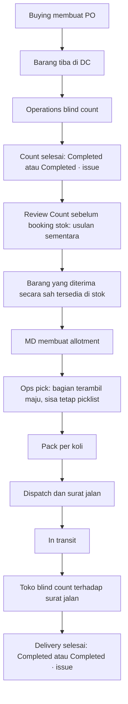
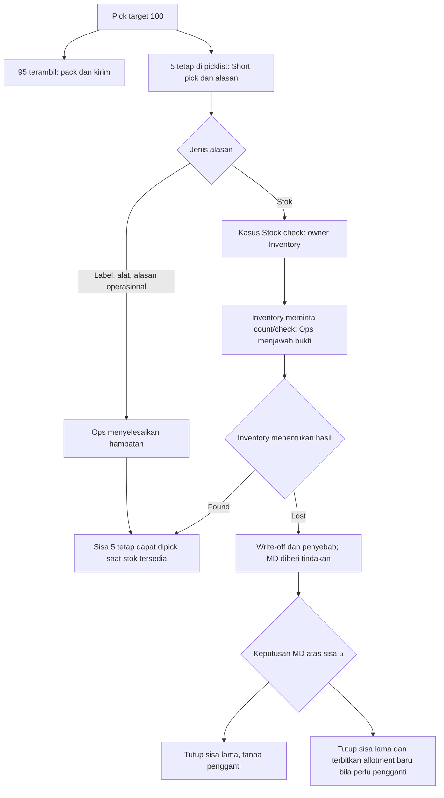
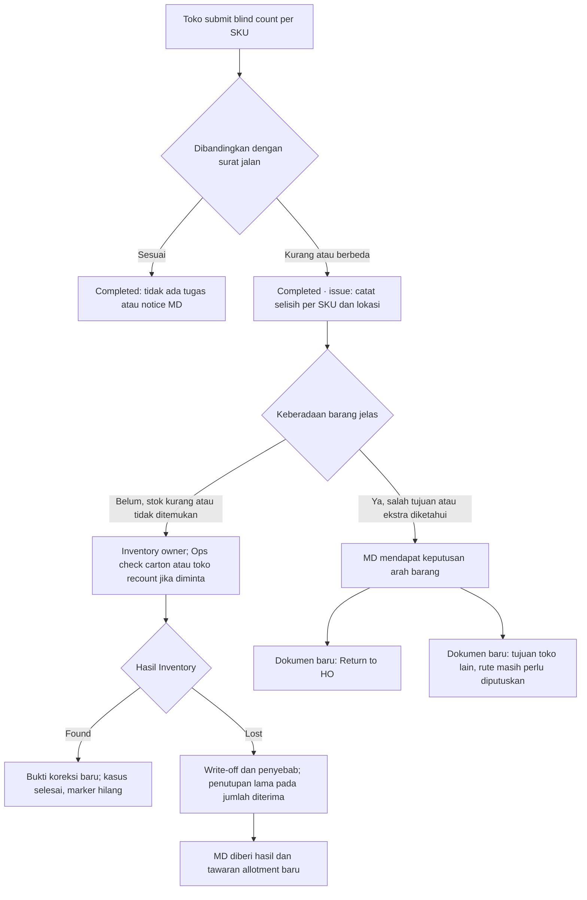
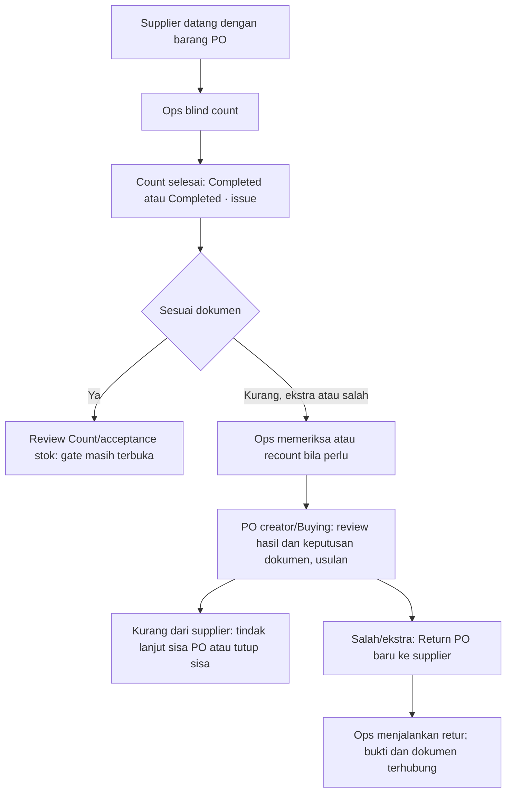
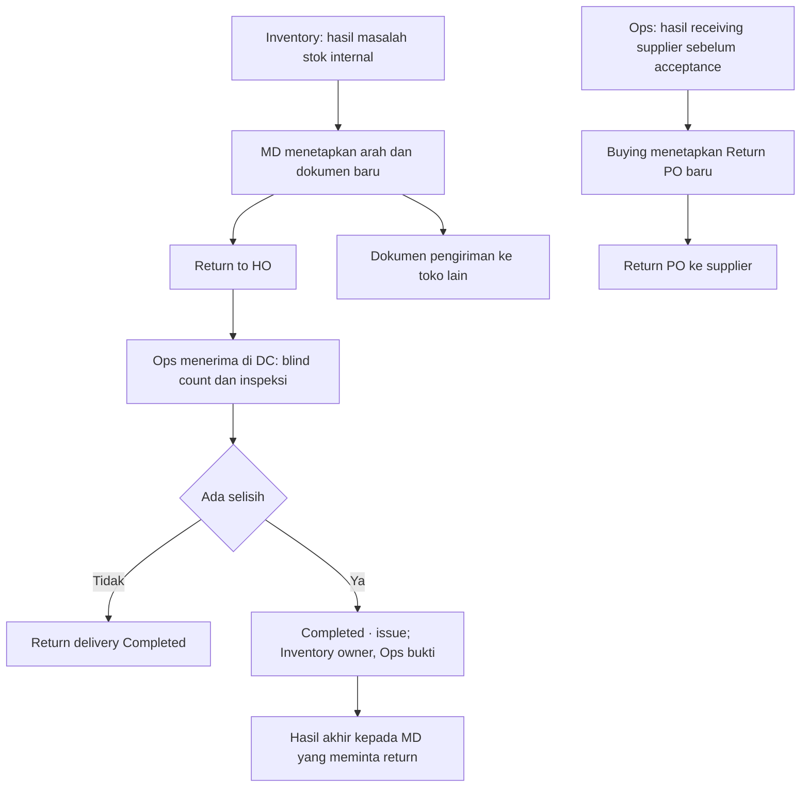

# Peta keseluruhan masalah alur barang

9 Oktober 2026. Berdasarkan model final yang diberikan Hari di chat, `inventory-issues-prototype.html`, dan `2026-10-09-outbound-cancel-edit-build.md`. Dokumen ini memetakan UX dan kepemilikan; bukan implementasi atau hasil tes aplikasi.

Model final menggantikan rekomendasi sebelumnya bahwa penerimaan kurang harus menahan delivery di status belum selesai, dan menggantikan replacement setelah Lost pada allotment yang sama.

Koreksi berikutnya dari Hari: receiving supplier sebelum barang diterima sebagai stok tidak melibatkan Inventory; masalahnya ditangani Ops dan pemilik PO. Inventory terlibat ketika keberadaan stok perusahaan dipertanyakan, termasuk saat picking dan receiving internal.

Klarifikasi UI MD berikutnya: salah barang/tujuan yang fisik dan jumlahnya sudah jelas dapat langsung menuju keputusan MD. Inventory terlibat bila keberadaan/jumlah stok belum jelas, tidak wajib menjadi perantara setiap keputusan arah barang. Usulan navigasi dan detail MD ada di [md-allotment-ux](2026-10-09-md-allotment-ux.md).

## Peta sederhana: tiga jalur, satu pola

Tidak perlu flow atau layar baru untuk tiap alasan. Semua masalah memakai pola `Laporan → pemeriksaan → keputusan → pekerjaan`, dengan pemilik sesuai jenis barang dan keputusan.

| Jalur | Urutan | Hasil |
|---|---|---|
| Supplier → DC, sebelum acceptance stok | Ops count/check → pemilik PO review dan putuskan → Ops menjalankan | Terima stok yang sah, tindak lanjut kekurangan supplier, atau Return PO baru. Tidak ada kasus Inventory untuk selisih sebelum acceptance. |
| Stok perusahaan / DC → toko | Ops/toko melaporkan → Inventory memeriksa keberadaan bila perlu → MD hanya bila perlu keputusan arah | Found: masalah selesai; Lost: tutup sisa/selesaikan dokumen lama dan tawarkan allotment baru; salah/ekstra internal: keputusan arah MD. Masalah alat/label/repack tetap diselesaikan Ops. |
| Pergerakan berdasarkan keputusan | MD/pemilik PO membuat dokumen → Ops mengirim/mengembalikan → tujuan count | Allotment baru, Return to HO, atau Return PO; selisih baru masuk jalur pemeriksaan yang sesuai. |

UI tetap memakai layar kerja Ops, daftar kasus Inventory untuk stok perusahaan, dan daftar tindakan MD/pemilik PO. Jenis masalah menjadi atribut/penanda pada kartu, bukan lane tambahan. Tugas bukti Ops berada di layar kerja Ops; keputusan akhir Inventory berada di kasus Inventory; keputusan dokumen berada di MD/PO owner.

Short pick: 95 yang terambil maju, 5 tetap picklist. Receiving internal: count selesai menjadi Completed atau Completed · issue. Found tanpa keputusan lanjutan tidak membuat notice MD baru. Return/allotment pengganti adalah dokumen baru, bukan membuka kembali dokumen lama.

## 1. Empat hal yang tidak dicampur

| Objek | Artinya | Pemilik |
|---|---|---|
| Dokumen count/delivery | Bukti apa yang benar-benar dihitung; selesai saat count dikirim | Counter dan kepala counter |
| Pekerjaan fisik | Pick, pack, check carton, recount, move back, kirim atau terima retur | Operations |
| Kasus Inventory | Pemeriksaan keberadaan stok perusahaan, hasil Found/Lost, penyebab dan write-off; bukan selisih supplier sebelum stock acceptance | Satu orang Inventory yang dinamai |
| Keputusan arah barang | Tutup sisa, allotment baru, Return to HO, tujuan lain; Return PO untuk barang supplier | MD; untuk PO disarankan pembuat PO/Buying, masih menunggu konfirmasi |

Completed pada delivery tidak berarti kasus selisihnya sudah selesai, seluruh allotment sudah terpenuhi, atau PO boleh dibayar. Barang salah/ekstra yang dihitung juga tidak otomatis menjadi stok tersedia.

`Completed · issue` = delivery/count sudah selesai dan masih ada kasus terbuka. Ketika kasus selesai, marker issue hilang; jumlah yang sebenarnya diterima dan riwayat tetap terlihat. Koreksi bukti diterbitkan sebagai catatan/dokumen koreksi baru yang terhubung, tidak menimpa count awal atau membuka delivery lama.

## 2. Alur normal dari supplier sampai toko

Review Count pada PO masih keputusan terbuka. Count selesai tanpa menunggu kasus selisih; jika gate dipertahankan, booking stok adalah langkah tersendiri. Pada layar jangan menyebut Completed sebagai Counted and booked sebelum stock acceptance benar-benar terjadi.

## 3. Sebelum toko menghitung: short pick dan gangguan Ops

Contoh: target 100, terambil 95. Sebanyak 95 maju untuk pack dan kirim. Sebanyak 5 tetap pada picklist allotment × toko × SKU yang sama. Ops melaporkan alasan; tidak menetapkan Missing.

- Short pick adalah flag pada picklist yang masih dapat dikerjakan, bukan state Blocked yang memerlukan Resume atau keputusan Wait.
- Bila hasil pick nol, semua jumlah tetap di To pick; tidak membuat kartu Picked kosong.
- Found sebelum permintaan lama ditutup memungkinkan pekerjaan sisa yang sudah ada diteruskan. Ini tidak membuka kembali dokumen yang sudah selesai dan tidak menambah demand.
- Setelah cancel/close atau Lost yang sudah diikuti penutupan sisa, Found belakangan tidak menghidupkan permintaan lama.
- Bila MD memilih allotment pengganti setelah Lost, sisa yang diganti pada dokumen lama harus ditutup agar tidak ada dua permintaan untuk kuantitas yang sama.
- MD melihat Target, Sent dan To pick sebagai progres. Notice yang meminta keputusan dikirim setelah Lost, bukan ketika Inventory masih menyelidiki. Tidak ada tugas MD untuk short pick akibat label/alat kecuali MD sendiri mengubah permintaan.

## 4. Gangguan lainnya sebelum count toko

| Kejadian | Pemilik langkah berikutnya | Penyelesaian dan notice |
|---|---|---|
| MD edit/cancel setelah pick/pack | Ops | Move back bagian terdampak; MD melihat jumlah pending/returned sejak awal. Bagian yang sudah terkirim tetap berjalan. |
| Isi koli salah, diketahui sebelum berangkat | Ops | Move back/repack; tidak perlu notice MD atau kasus Inventory jika tidak ada masalah keberadaan barang. |
| Barang tidak ditemukan di koli sebelum berangkat | Inventory | Minta bukti Ops, tetapkan Found/Lost; MD setelah Lost. |
| Truk terlambat atau barang diduga hilang di jalan | Inventory | Keterlambatan adalah laporan untuk diselidiki, bukan Lost otomatis. Found/Lost dan penyebab berdasarkan bukti; MD setelah Lost. |
| Koli sudah In transit | Inventory/Ops sesuai tugas bukti | Tidak dapat Move back atau cancel; masalah isi diperiksa pada count tujuan. |

## 5. Toko menerima barang: count selesai, masalah punya jalur sendiri

Untuk selisih keberadaan stok, Operations dan Inventory mendapat notice awal bersama. Inventory memiliki keputusan kasus; Ops menerima tugas bukti yang konkret, misalnya Check carton KOLI-X, 5 pcs. Jika seluruh barang diketahui dan masalahnya arah, MD mendapat keputusan tanpa pemeriksaan Inventory wajib. Ops tidak diberi tombol Found/Lost dan tidak menentukan tujuan retur. Counter toko bertanggung jawab atas count dan menjawab recount. Salah SKU yang sekaligus membuat SKU asli kurang dapat memiliki pekerjaan MD dan Inventory terkait untuk kuantitas yang berbeda.

MD dapat melihat status delivery dan marker issue sebagai informasi. Selama penyelidikan berjalan MD tidak mendapat tugas yang menyuruh menentukan keberadaan barang. Setelah hasil:

| Hasil | Apa yang dilihat/dikerjakan MD |
|---|---|
| Count cocok | Progres diperbarui; tidak perlu notice atau tindakan. |
| Selisih masih diperiksa | Informasi Completed · issue; Inventory owns case. Tidak perlu intervensi. |
| Found dan semuanya selesai | Hasil tercatat; tidak perlu notice tindakan. |
| Lost terkonfirmasi | Notice tindakan: jumlah diterima, lost, penyebab; allotment lama ditutup pada penerimaan aktual; buat allotment baru bila ingin pengganti. |
| Salah/ekstra, bukan stok | Notice tindakan: pilih Return to HO atau tujuan lain, kemudian terbitkan dokumen baru. |

Found tidak memicu toko mengonfirmasi delivery lama lagi. Lost tidak mengembalikan kuantitas receipt yang kurang ke To pick/To pack pada allotment lama.

### Dua contoh yang berbeda

1. Target allotment 100, surat jalan hanya 95, toko menghitung 95. Delivery **Completed** tanpa issue. Sisa 5 yang belum pernah dikirim tetap pekerjaan picklist lama, selama belum ditutup. Selisih receiving dibandingkan dengan 95 pada surat jalan, bukan target 100.
2. Surat jalan 100, toko menghitung 95. Delivery **Completed · issue**; 5 diselidiki Inventory. Tidak otomatis membuat picklist pengganti 5. Jika Lost, dokumen lama diselesaikan pada 95 dan MD memutuskan allotment baru untuk pengganti.

## 6. Supplier → DC sebelum acceptance: Ops dan pemilik PO

Perbedaan yang harus jelas:

- Supplier mengirim 95 dari PO 100 bukan Lost 5 milik perusahaan. Ops memastikan fakta count/recount; Buying menindaklanjuti kekurangan supplier. Inventory tidak dilibatkan untuk selisih barang yang belum diterima sebagai stok. Write-off hanya untuk kehilangan stok perusahaan yang memang sudah ada dan dapat dibuktikan.
- Ekstra/salah terkonfirmasi tidak otomatis menjadi stok yang dapat diallotkan. Default retur melalui Return PO adalah usulan untuk alur ini; Ops menyerahkan hasil kepada pemilik PO, pemilik PO menerbitkan keputusan/dokumen, Ops mengirim fisiknya.
- Count selesai tidak otomatis berarti PO selesai atau supplier boleh dibayar. PO dapat memiliki beberapa delivery; delivery berikutnya memakai receipt baru. Tidak membuka receipt lama. Kebijakan apakah sisa PO dibiarkan terbuka atau ditutup adalah keputusan PO owner.
- Bila bisnis hendak menerima barang ekstra, perlu keputusan dan dokumen komersial baru yang sah; jangan memasukkan tombol Add to stock di keputusan Inventory. Ini bukan jalur otomatis dalam model final yang diberikan Hari.
- Review Count dan siapa penerima keputusan terakhir PO masih perlu konfirmasi. Untuk peta sementara, dipakai Review Count sebelum stok dibooking dan Buying sebagai pemilik dokumen PO. Setelah barang diterima sebagai stok, kehilangan berikutnya masuk jalur Inventory seperti stok perusahaan lainnya.

## 7. Retur dan pengiriman koreksi

Dokumen koreksi membawa referensi kasus dan dokumen asal. Delivery/allotment yang sudah selesai tidak dibuka kembali. Perjalanan retur punya progresnya sendiri; penyelesaian kasus Inventory dan pemenuhan pekerjaan retur ditampilkan terpisah. Inventory tidak membuat dokumen pergerakan dan tidak memindahkan fisik.

Rute dari toko langsung ke toko lain atau melalui DC masih terbuka; peta tidak memilihkannya sebagai keputusan final. Not as Ordered pada store juga belum diaktifkan sebagai field wajib karena definisi dan disposisinya masih terbuka. SKU tambahan/berbeda yang tercatat saat count tetap dapat memicu kasus berdasarkan perbandingan per SKU.

## 8. Komunikasi UI

| Layar | Informasi utama | Aksi pemilik |
|---|---|---|
| Ops picklist | Target, picked, sisa; Short pick dan alasan | Pick bagian yang tersedia, laporkan alasan sisa, jawab count/check. Tidak ada Missing/Lost/Wait/Resume. |
| Ops packing/outbound | Isi koli dan jumlah; edit/cancel dan pekerjaan return tersisa | Pack, Move back, repack, dispatch bagian yang memenuhi syarat. |
| Receive toko/DC | Blind sebelum submit; sesudahnya expected, counted, difference per SKU, Completed/issue | Submit count; jawab recount sebagai bukti baru bila diminta. |
| Inventory cases | Dokumen sumber, lokasi/custody, expected/count, bukti, satu owner, umur, next task | Minta pemeriksaan, putuskan Found/Lost dengan penyebab saat keberadaan stok dipertanyakan. |
| MD | Progres; hasil Lost atau barang salah/ekstra yang sudah terverifikasi | Close remaining sebelum sent, allotment baru setelah Lost, Return to HO, tujuan lain. |
| Buying/PO owner, usulan | Hasil penerimaan dan keputusan barang supplier | Review Count bila tetap berlaku; tindak lanjut sisa PO; Return PO. |

Kasus Inventory yang melewati 30 hari menjadi merah. Jangan mengarang SLA yang sama untuk Move back atau tugas MD. Counter dan kepala counter menjawab bukti count; Inventory menjawab waktu penyelesaian dan write-off. Cause loss mencatat DC packing, In transit, Store, atau Unknown berdasarkan bukti; custody berpindah saat barang diserahkan di pintu, bukan saat Inventory menutup kasus. Finance melihat hasil jurnal write-off, tidak menentukan Found/Lost atau arah barang.

## 9. Bagian yang masih perlu keputusan

1. PO: Review Count tetap gate booking stok, atau dihapus? Peta memakai tetap sebagai usulan.
2. PO: pemilik terakhir Buying/PO creator atau MD? Peta menyarankan Buying untuk dokumen PO.
3. Store Not as Ordered: definisi jumlah dan apakah selalu return; tetap belum diaktifkan.
4. Lost bernilai besar: perlu orang kedua dan ambang berapa; belum ditambahkan sebagai gate.
5. Lost → allotment baru dipakai sesuai empat aturan final; catatan lama To Pack replacement pada allotment yang sama dianggap superseded. Konflik dengan daftar Still to confirm dicatat agar implementasi tidak memakai keduanya.
6. Toko lain: direct atau via DC; belum dipilih.

## 10. Catatan konsistensi prototype

- Prototype masih memasukkan selisih receiving PO sebelum acceptance ke Inventory; ini perlu disesuaikan dengan koreksi Hari: Ops dan pemilik PO, tanpa Inventory pada langkah ini.
- `outcome()` sudah menyebut PO owner untuk Return PO, tetapi `trail()` dan tabel alur PO masih menyebut MD. Pilih satu dan konsistenkan setelah keputusan PO owner.
- Teks Completed · issue di halaman keputusan masih menyebut Counted and booked. Itu tidak aman dijadikan definisi PO sampai Review Count diputuskan.
- `trail()` masih dapat menyebut MD told: nothing to act on untuk Found. Jika tidak ada tindakan, simpan hasil di riwayat tanpa notice baru sesuai model final.
- Model final dan peta ini adalah target. Work status yang diberikan Hari tetap written/not compiled/not deployed; tidak ada build atau deployment dilakukan dalam penyusunan peta.
