# Batas mundur: PO, count, kirim toko, Return to HO, dan supplier

9 Oktober 2026. Peta UX target beserta bukti source yang diperiksa. Hari mengonfirmasi Recall berarti menarik kembali hasil count yang disubmit tetapi belum diterima reviewer. Bukan menarik barang yang sudah dikirim. Tidak ada build atau perubahan aplikasi.

## 1. Arti tindakan

| Tindakan | Mengubah apa | Batas |
|---|---|---|
| Back | Navigasi/form belum disubmit | Selalu dapat meninggalkan layar; tidak membatalkan dokumen yang sudah disimpan |
| Edit | Rencana/dokumen yang masih diizinkan, melalui revisi tercatat | Tidak mengubah bukti receipt atau quantity yang sudah dikirim |
| Recall count | Menarik submission yang masih menunggu review | Hanya bagian yang belum Accepted/Resolved/posted; count lama tersimpan sebagai Recalled, hasil baru terhubung ke arrival/scope yang sama |
| Recount | Meminta pemeriksaan ulang | Count baru, count lama tetap tersimpan; bukan overwrite atau membatalkan movement lama |
| Cancel / Close remaining | Mengakhiri permintaan yang belum terlaksana | Tidak membatalkan fisik yang sudah dikirim atau menerima barang yang belum ada |
| Move back | Ops membalik pekerjaan fisik sebelum keberangkatan | Picked → To pick, Packed → Picked/To pick; tidak dari In transit |
| Correction / Return | Fakta/dokumen baru untuk memperbaiki akibat yang sudah terjadi | Menautkan sumber dan tidak membuka dokumen selesai |

Recall bukan penghapusan. Penerima review tidak boleh Accept count yang sudah Recalled. Operator menghitung lagi pada arrival/scope yang sama; tidak mengaku supplier mengirim delivery kedua. Jika sebagian baris telah accepted, tidak boleh menarik semuanya: bagian accepted tetap, Recall hanya untuk submission/baris yang masih menunggu.

## 2. Peta tahap

### Supplier → PO → DC

| Tahap | Bisa mundur? | Aksi dan pemilik | Yang tetap |
|---|---|---|---|
| Basket/form PO belum Submit | Ya | Buying Edit / Back | Belum ada PO; jangan membuat status Draft PO baru |
| PO sudah issued, belum penerimaan/bill/advance, tidak ada count menunggu | Terbatas | Buying Edit sesuai eligibility / Cancel | PO cancelled tetap menjadi riwayat; pembatalan memberi tahu DC |
| Goods arrived, count masih diisi | Ya pada form | Ops Edit input / Back | Arrival yang sudah dibuat tetap fakta kedatangan |
| Count submitted, menunggu Review Count | Ya pada submission | Counter: Recall count; reviewer: Recount | Count lama tetap riwayat; tidak ada pengubahan stok dari Recall |
| Count sudah diterima sebagian | Hanya bagian pending | Recall pending / Recount | Baris accepted tidak ditarik kembali |
| Count accepted, receipt/stok tercatat | Tidak untuk receipt | Bukti koreksi/count baru; stok kurang/beda setelah acceptance diperiksa Inventory | Count/receipt asli tetap; movement tidak dihapus |
| PO partially received | Hanya sisa order | Buying Close Short; penerimaan berikutnya receipt baru jika sisa tetap terbuka | Receipt yang sudah accepted tetap |
| PO completed/closed/cancelled | Tidak | Order/return/koreksi baru sesuai kasus | Tidak reopen PO atau menimpa receipt |

Acceptance bukan izin bayar. Koreksi Finance tidak dipetakan sebagai undo penerimaan stok. Peta ini fokus barang; bill/payment mempunyai batas sendiri.

### DC → toko

| Tahap | Bisa mundur? | Aksi dan pemilik | Yang tetap |
|---|---|---|---|
| Allotment form belum Submit | Ya | MD Edit / Back | Belum ada permintaan tersimpan |
| Allotment issued, belum picked | Ya pada bagian belum sent | MD Edit / Cancel / Close remaining | Revisi tercatat; tidak revive cancelled demand |
| Picked | Ya secara fisik | Ops Move back; MD edit/cancel membuat pekerjaan pengembalian | Bagian lain dapat lanjut |
| Packed, belum In transit | Ya secara fisik | Ops unpack/Move back; MD edit/cancel mengharuskan bagian terdampak dikeluarkan | Surat jalan/koli yang berubah harus memiliki riwayat void/reissue bila sudah bernomor, bukan diam-diam ditimpa |
| Short pick 95/100, sisa 5 belum dikirim | Tidak perlu undo bagian 95 | Ops lanjut 95; 5 tetap picklist; Inventory stock check bila stok tidak jelas | Found bukan step baru atau pick otomatis |
| Sudah In transit | Tidak Move back/Recall kiriman | Count tujuan, lalu Return/dokumen koreksi baru bila perlu | Sent tetap sent; MD hanya dapat menutup/mengubah bagian lain yang belum sent |
| Receive toko, count masih diisi | Ya pada form | Counter Edit input / Back | Belum ada receipt baru dari input yang belum disubmit |
| Receive count disubmit dan langsung menjadi receipt | Tidak Recall receipt | Recount/koreksi baru; Inventory memeriksa selisih | Delivery Completed; bukti count awal dan qty aktual tersimpan |
| Allotment sudah selesai/ditutup | Tidak | Return to HO / allotment baru, jika MD memutuskan | Tidak reopen atau top-up dokumen selesai |

Jangan menambahkan gate review receiving toko hanya agar tombol Recall bisa ditampilkan. Model sekarang count selesai langsung mencatat receipt; ini berbeda dari count PO yang menunggu acceptance. Jika gate baru ingin diperkenalkan, itu keputusan proses baru, bukan sekadar tombol yang disalin.

### Toko → Return to HO → DC → toko kembali

| Tahap | Bisa mundur? | Aksi dan pemilik | Yang tetap |
|---|---|---|---|
| MD mengisi New Return | Ya | MD Edit / Back | Toko tidak membuat retur sendiri |
| Return request dibuat, toko belum send | Terbatas, target perlu dukungan | MD Edit / Cancel bagian belum sent | Permintaan dan revisi tetap riwayat |
| Toko menyiapkan jumlah aktual | Ya sebelum send | Ubah jumlah aktual; laporkan alasan sisa | Tidak perlu board picking toko |
| Toko Pack and send sudah berhasil | Tidak mundur dari In transit | DC count; koreksi/return baru bila salah | Dispatch tidak boleh dibatalkan hanya dengan Back/Refresh |
| DC mengisi count return | Ya pada form | Ops Edit input / Back | Kedatangan tetap fakta |
| DC Submit count sudah mencatat receipt/stok retur | Tidak Recall receipt | Pemeriksaan Inventory / recount atau koreksi baru | Count asli dan yang sudah diterima tidak dihapus |
| Stok retur DC hendak dikirim ke toko | Dokumen baru | MD membuat allotment baru dari stok yang memenuhi syarat | Tidak membalik dokumen Return to HO lama |
| Sudah dikirim lagi ke toko | Ikuti batas DC → toko | Sebelum In transit bisa Move back; sesudahnya receipt/return baru | Semua dokumen saling terhubung |

Partial return masih celah implementasi: requested 20, sent 15 harus memiliki sisa 5 yang eksplisit; received 15 terhadap sent 15 bukan kekurangan receiving. Lost atas sisa 5 tidak mengakhiri bagian 15 yang masih dalam perjalanan.

### DC → supplier

| Tahap | Bisa mundur? | Aksi dan pemilik | Yang tetap |
|---|---|---|---|
| Form return belum Confirm | Ya | PO owner/Buying Edit / Back | Belum ada dokumen return diterbitkan |
| Return diterbitkan, belum picked/packed/hand-over | Secara fisik masih bisa berhenti; cancel/void dokumen belum terpetakan lengkap | Usulan Cancel return oleh pemilik dokumen, void surat jika ada, release pekerjaan Ops | Jangan menampilkan Cancel yang hanya mengubah status tanpa membebaskan stok/reservasi |
| Sudah picked/packed, belum keluar | Bisa membalik fisik; perlu cancel dokumen yang konsisten | Ops Move back; pemilik dokumen menutup/void bagian belum dikirim | Riwayat surat jalan tetap |
| Sudah In transit/hand-over supplier | Tidak Move back | Bukti supplier, claim/koreksi terhubung bila perlu | Jangan mengaku barang masih di DC |
| Return PO atas salah/berlebih penerimaan | Setelah hand-over selesai; tidak reopen | Koreksi baru bila bukti hand-over salah | Tidak otomatis menunggu replacement atas barang ekstra yang tidak dibeli |
| Return stok HO yang supplier wajib selesaikan | Barang sudah keluar; settlement tetap terbuka | Replacement / Refund / Credit note atau Close Short sisa kewajiban oleh Buying | Tidak membuka ulang fisik return; koreksi settlement lewat catatan reversal/koreksi baru |
| Supplier mengirim replacement | Penerimaan baru | Ops count → PO owner review; Recall hanya saat count masih pending acceptance | Tidak menambah receipt pada delivery lama atau menghapus return awal |
| Return/settlement selesai atau closed short | Tidak reopen | Dokumen/catatan koreksi baru | Bukti asli, nilai, dan keputusan penutupan tetap tersedia |

## 3. Inventory count dan Resolve

| Tahap | Bisa mundur? | Aksi |
|---|---|---|
| Count/evidence belum disubmit | Ya pada form | Edit / Back |
| Count submitted menunggu review, belum mengubah stok | Ya, target Recall yang disepakati Hari | Recall count oleh pengirim yang berwenang; reviewer meminta Recount bila perlu |
| Resolve belum disimpan | Ya pada form | Ubah result, qty, lokasi/penyebab |
| Resolve/adjustment sudah disimpan | Tidak undo/delete langsung | Koreksi/adjustment baru berreferensi hasil lama |
| Stock located setelah kasus/demand lama ditutup | Tidak revive demand | Catat fakta lokasi/koreksi baru; MD diberi informasi |

Stock located dan Loss confirmed sama-sama hasil Resolved. Resolve tidak otomatis memindahkan fisik atau membuat allotment. MD cukup mengetahui hasil; tidak ada Needs action atau kewajiban pengganti otomatis.

## 4. Grafik batas

```mermaid
flowchart LR
  P[PO issued] --> C[Count submitted]
  C --> A[Accepted: receipt dan stok DC]
  C -->|Recall sebelum accepted| N[Count baru, arrival sama]
  N --> C
  C -->|Recount diminta reviewer| N
  A --> AL[Allotment baru]
  AL --> PK[Picked]
  PK --> PA[Packed]
  PA --> TR[In transit]
  PA -->|Move back sebelum transit| PK
  PK -->|Move back| AL
  TR --> ST[Store count: Completed]
  ST --> RH[Return to HO baru]
  RH --> RT[In transit ke DC]
  RT --> DC[DC count: stok retur]
  DC -->|MD allotment baru| AL
  A -->|Salah atau ekstra pada PO| RP[Return PO]
  DC -->|Buying return baru| RS[Return stok HO ke supplier]
  RP --> HO[Hand-over supplier: selesai]
  RS --> SET[Hand-over: settlement menunggu]
  SET --> END[Replacement, refund, credit note atau Close Short]
```

Panah Move back pada grafik adalah pekerjaan fisik pada allotment yang sama; bukan membuka ulang allotment cancelled. Barang yang sudah diambil keluar oleh MD dikembalikan tanpa menciptakan To pick baru.

## 5. Bukti as-is dan celah yang harus ditutup

- PO Review Count sudah punya Recount, Partial Receive, Close Short (`frontend-hub/src/screens/procurement/count-review.tsx`). Recall oleh counter belum ditemukan pada layar/route count yang diperiksa.
- Domain official count sekarang hanya mengizinkan Draft → Active → Review → Closed (`backend/src/cloud/domain/count.rs`). Recall dari Review memerlukan dukungan state/event dan invalidasi review yang eksplisit; bukan tombol UI saja.
- PO Cancel sudah membatasi order yang eligible dan menonaktifkan Cancel jika count sedang menunggu/recount (`frontend-hub/src/screens/procurement/purchase-orders.tsx`). Recall tidak otomatis menghapus arrival atau menjadikan seluruh PO boleh dibatalkan.
- MD edit/cancel dan Move back mengikuti build spec 9 Oktober; belum diklaim teruji/deployed. Edge dan cloud memiliki cakupan berbeda dalam spec tersebut.
- Return toko sekarang dispatch seluruh request lewat Pack and send; partial send/shortage serta edit/cancel pending return perlu pemeriksaan kontrak dan dukungan eksplisit.
- Receive toko dan receive-return DC sudah melakukan blind count dan comparison sesudah receipt. Recall receipt setelah Submit bukan perilaku yang boleh diasumsikan dari PO.
- Supplier-return routes/source yang diperiksa memuat create/list/settlement/close-short dan hand-over. Cancel/void return sebelum keluar belum punya flow lengkap yang terverifikasi dalam peta; harus ditetapkan, tidak mengklaim sudah tersedia.
- Surat sudah bernomor, partial accepted/sent, Recall bersamaan dengan reviewer Accept, serta koreksi adjustment/settlement setelah posting memerlukan boundary per bagian dan jejak versi/reversal.
- Retry setelah koneksi putus memeriksa hasil tindakan/idempotency key yang sama. Retry bukan Recall, bukan delivery kedua, dan bukan booking stok kedua.
- Hasil count nol, partial resolve (3 located, 2 loss), barang rusak yang masih ada, dan transaksi stok selama count tetap merupakan kasus yang perlu aturan lebih rinci.

Dokumen lifecycle lama yang mewajibkan Finance approval/maker-checker tambahan tidak dijadikan aturan baru; itu bertentangan dengan keputusan chat bahwa Inventory menetapkan kehilangan dan Finance melihat jurnal. Tidak ada gate tambahan disisipkan dalam peta ini.
