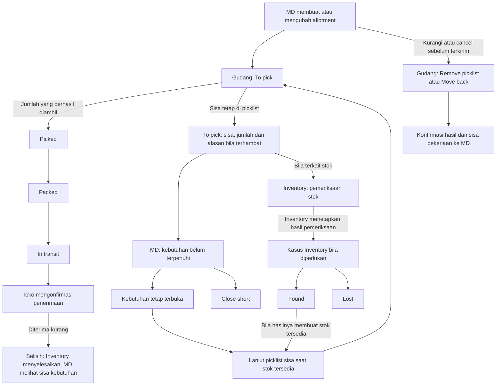

# Review UI/UX dan komunikasi outbound

Tanggal: 9 Oktober 2026. Ditinjau bersama subagent gpt-6-luna dengan reasoning max.

**Catatan pembaruan:** aturan final berikutnya mengubah penerimaan menjadi Completed atau Completed · issue, dan replacement setelah Lost memakai dokumen baru. Rekomendasi status/pemenuhan lama di review ini adalah historis. Peta terbaru: [goods-flow-map](2026-10-09-goods-flow-map.md).

Objek: `http://localhost:5397/outbound-board-prototype.html?x=5`, file `outbound-board-prototype.html`, dan ringkasan agen sebelumnya. Fokus: apakah layar membantu MD, gudang, Inventory, dan toko memahami keputusan pihak lain dan tindakan berikutnya. Ini review; prototype dan aplikasi tidak diubah.

## Kesimpulan

Lima lane tepat sebagai workspace gudang untuk proses normal. Tombol per tahap, detail sheet, stempel perubahan, dan konfirmasi sebelum perpindahan adalah dasar yang baik. Namun komunikasi dua arah belum lengkap. MD ke gudang lebih jelas daripada Inventory ke MD, MD ke Inventory, dan balasan gudang ke MD. Beberapa status memberi kesan selesai meskipun pekerjaan atau kekurangan masih terbuka.

Ringkasan sebelumnya terutama membuktikan perbaikan tampilan dan cancel/edit. Itu belum membuktikan seluruh use case lintas peran tercakup.

## Koreksi pemilik keputusan dari pengguna

Ops hanya melaporkan pekerjaan tidak bisa dilanjutkan, jumlah yang terdampak, dan alasannya. Laporan ini bukan penetapan Inventory Missing. Contoh: `Cannot continue picking · 6 pcs unfulfilled · stock check needed`. Jika masalahnya terkait stok, Inventory memeriksa dan menetapkan hasilnya melalui proses Inventory sendiri. Jika masalahnya operasional, penyelesaiannya tetap di Ops. MD melihat kebutuhan yang belum terpenuhi dan memilih kelanjutan permintaan; MD juga tidak menetapkan keadaan fisik barang.

Pemisahan pada UI: `Blocked / Cannot continue` adalah keadaan pekerjaan Ops; `Unfilled / Still needed` adalah sisa kebutuhan MD; `Missing / Found / Lost` hanya ditampilkan sebagai hasil proses Inventory, bila proses tersebut memang ada. Prototype yang otomatis membuat Missing ketika pick kurang adalah celah alur yang perlu diperbaiki, bukan perilaku yang disarankan.

## Koreksi partial pick dari pengguna

Jika target 100 dan yang terambil 95, 95 lanjut ke Picked → Packed → dikirim; 5 tetap di picklist To pick pada allotment × toko × SKU yang sama. Kekurangan tidak menahan bagian yang sudah siap. Sisa tidak dihapus, tidak dianggap dibatalkan, dan tidak otomatis menjadi Missing. Penanda Cannot continue hanya berlaku pada sisa yang belum dapat dikerjakan, bila perlu disertai alasan.

MD melihat `Target 100 · Picked/Sent 95 · To pick 5`. Sisa tetap dapat dipick ketika stok tersedia tanpa persetujuan Wait tambahan dan tanpa membuat kebutuhan baru. Jika ada tampilan Unfilled di MD, angka 5 adalah pembacaan sisa picklist yang sama, bukan kuantitas tambahan. MD dapat menutup atau membatalkan sisa 5 sesuai keputusan permintaan; 95 yang sudah berjalan tetap berjalan. Jika hasil pick nol, seluruh jumlah tetap di To pick dan tidak ada kartu Picked kosong.

Di gudang, bagian yang maju dan sisa picklist boleh menjadi kartu terpisah menurut lane, tetapi keduanya harus menunjukkan allotment dan toko yang sama. Hitungan toko menggunakan toko unik. Setelah 95 diterima, allotment masih terbuka untuk sisa 5; selesai setelah sisa dipenuhi atau ditutup MD. Ini adalah celah prototype sekarang: short pick dipindahkan ke daftar UNF dan otomatis dibuatkan MIS, tanpa menyisakan picklist untuk jumlah kurang.

## Peta alur yang sudah ada



Diagram memasukkan tujuan komunikasi yang perlu dilengkapi. Pemeriksaan Inventory tidak otomatis berarti Missing. Found/Lost berlaku pada kasus yang ditetapkan Inventory. Cabang Lost, konfirmasi hasil ke MD, dan penyelesaian selisih penerimaan belum lengkap di prototype.

## Apa yang sudah tepat

| Pola UI | Mengapa membantu |
|---|---|
| Lima lane gudang | Operator tahu posisi kerja dan aksi berikutnya. |
| Tombol Picked / Pack / Dispatch | Menyediakan cara selain drag, termasuk untuk phone. |
| Drop membuka dialog | Operator meninjau jumlah sebelum perubahan dilakukan. |
| Stempel EDITED / CANCELLED | Keputusan MD terlihat di tempat gudang bekerja. |
| Dialog cancel menyebut jumlah picked, packed, dan sent | Dampak keputusan dapat dipahami sebelum konfirmasi. |
| Move back per baris dan jumlah | Pengembalian sebagian memiliki jalur yang dapat diperiksa. |
| Pemisahan layar MD dan Inventory | Keputusan permintaan dan keadaan fisik barang memiliki pemilik berbeda; hubungan otomatis short pick → Missing pada prototype perlu dikoreksi. |

## Peta komunikasi dua arah

| Arah | Sudah ada | Belum cukup |
|---|---|---|
| MD → Gudang | Stempel, jumlah pengurangan, tombol pengembalian, larangan lanjut | Alasan edit/cancel perlu konsisten tersedia; bedakan target baru dari jumlah fisik yang belum kembali. |
| Gudang → MD | Angka tahap berubah dan Activity | Hasil parsial perlu terbaca langsung: dikembalikan berapa, sisa berapa, siapa dan kapan; jangan hanya hilangkan kartu/stempel. |
| Gudang → Inventory | Prototype otomatis membuat Missing saat short pick; ini keliru | Ops melaporkan tidak bisa lanjut, jumlah, alasan, dan lokasi yang relevan. Inventory memeriksa dan menetapkan hasilnya sendiri; masalah nonstok tetap diselesaikan Ops. |
| MD → Inventory | Kasus terhubung lewat allotment | Inventory tidak melihat MD sedang Wait, sudah Close short, atau sudah Cancel; keputusan demand tidak tampak pada kasus. |
| Inventory → MD | Found dapat memicu Pick again setelah Wait | Lost tidak mengganti Waiting for stock menjadi hasil penyelidikan dan tindakan berikutnya. Found juga perlu menjelaskan apakah stok kembali dialokasikan atau bebas. |
| Toko → MD/Inventory | Kartu Received menunjukkan diterima/ekspektasi | MD menyembunyikan kekurangan melalui angka dan status yang salah; kasus Missing penerimaan belum dibentuk oleh stand-in penerimaan. |

## Celah yang terkonfirmasi dan perubahan pada layar

### 1. Cancel masih bisa diikuti Pick again

Reproduksi melalui UI:

1. Pick Kemang ALT-0412 sebanyak 239 dari 240.
2. Cancel ALT-0412 dengan kontrol simulasi prototype.
3. MD → Unfilled masih menawarkan Wait untuk 1 pc dari ALT-0412.
4. Pilih Wait, lalu Inventory → Found.
5. Ops membuat kartu aktif `Pick again · 1 pcs · ALT-0412` di samping kartu CANCELLED.

Ini masalah kepercayaan terhadap UI: MD merasa telah membatalkan, gudang mendapat pekerjaan baru untuk permintaan yang sama.

Perbaikan UX: baris Unfilled menjadi `Demand cancelled · no further picking`; Wait tidak tersedia. Missing tetap diselidiki. Ketika Found, tampilkan `Found 1 · returned to available stock · demand cancelled`, tanpa Pick again. Kasus Inventory tidak ditutup otomatis hanya karena MD membatalkan permintaan.

Bukti: `doCancel` hanya mengubah kartu, baris 1362–1375; `pickAgain` hanya memeriksa Wait dan Found, baris 638–647.

### 2. Received tidak berarti allotment terpenuhi penuh

Data awal Ops menunjukkan PIK ALT-0401 menerima 214/220 dan 6 missing. Di MD allotment tersebut tampil Completed dan ringkasan menggunakan 220, bukan 214. Ini diverifikasi di layar.

Perbaikan UX: MD menampilkan `Received 214/220 · Missing 6 · Inventory investigating`. Allotment tetap terbuka selama kekurangan belum diselesaikan. Lane Received boleh berisi receipt yang sudah dikonfirmasi; status allotment harus menjelaskan apakah pemenuhan penuh atau masih ada selisih.

Jika Inventory Found atas selisih penerimaan, hasilnya memperbaiki bukti penerimaan. Jika Lost, kebutuhan pengganti tetap terbuka sampai dipenuhi atau MD menutupnya. Barang rusak yang benar-benar diterima tetap dihitung diterima, dengan kasus kondisi barang tersendiri.

Bukti: `statusOf` baris 859 hanya memeriksa lane; `rowOf` baris 868 dan angka sheet sekitar 936 memakai `pcs`, bukan `got`; stand-in `storeConfirms` baris 614 belum membuat kasus selisih.

### 3. Waiting menjadi jalan buntu setelah Lost

MD yang memilih Wait tetap melihat Waiting for stock setelah Inventory memilih Lost. Tombol keputusan hanya tersedia saat Unfilled berstatus open; baris wait tidak punya tindakan lagi.

Perbaikan UX: gunakan dua informasi: `Inventory: Lost 6` dan `Demand: 6 still needed`. Tampilkan langkah berikutnya sesuai kebijakan: menunggu stok pengganti / pemenuhan pengganti, atau MD memilih Close short. Wait perlu dapat ditinjau kembali, dengan umur tunggu dan pemilik tindak lanjut. Stok baru yang masuk juga harus dapat memenuhi sisa kebutuhan; tidak hanya Found dari kasus Missing yang sama.

Bukti: baris 639–647 dan 886–892.

### 4. Cancelled belum menjelaskan pekerjaan pengembalian yang tersisa

Status Cancelled langsung tampil di MD, meskipun gudang belum mengembalikan barang. Untuk campuran kartu sent + cancelled, ringkasan MD dapat tidak menunjukkan pekerjaan return segera, karena pend tidak menghitung cancelled dan status keseluruhan masih Active.

Perbaikan UX: pisahkan keputusan dan pekerjaan: `Cancellation requested · return 80`, lalu `Returned 30/80 · 50 remaining`, lalu `Cancellation complete`. Untuk pembatalan sisa setelah sebagian dikirim: `Sent 120 continues · 80 cancelled · 50 awaiting return`. Setelah sisa pekerjaan dan penerimaan selesai, tampilkan hasil Closed short, bukan Completed penuh.

Label `Waiting for warehouse · 3 h` lebih jelas daripada `Not confirmed 3 h`. Ambang dua jam adalah keputusan SLA, bukan penentu apakah pekerjaan ada; indikator pending harus muncul sejak awal.

Bukti: baris 686, 859, 871–875, 1362–1377.

### 5. Satu angka pcs mencampur target dan barang fisik

Packed 100, MD mengurangi menjadi 80, tetapi 20 belum dikembalikan. Kartu dan total lane menggunakan 80. Operator perlu tahu masih ada 100 secara fisik dan 20 wajib kembali.

Perbaikan UX: `Keep 80 · Return 20 pending`. Setelah kembali 10: `Keep 80 · Return 10 remaining · Returned 10`. Pada Move back biasa, jelaskan mana yang harus dipick lagi dan tetap teralokasi, serta mana yang dikeluarkan MD dan menjadi tersedia setelah kembali. Semua itu menggunakan satu pola Move back, dengan hasil yang eksplisit.

Bukti: angka kartu baris 709–714 dan total lane baris 751 memakai target; rencana Move back baris 1241–1251 sebenarnya sudah membedakan excess dan keep tetapi belum memberi ringkasan lintas peran yang cukup.

### 6. Instruksi koli belum bisa dipercaya untuk pengembalian sebagian

Input packing membolehkan SKU yang sama dibagi ke beberapa koli. Setelah Done, detail isi tersebut hilang: hanya total koli disimpan, lalu penempatan SKU ke koli ditentukan dari urutan baris. Akibatnya petunjuk Move back dapat menunjuk koli yang salah.

Perbaikan UX: detail koli harus mempertahankan isi SKU dan jumlah persis, termasuk SKU yang berada pada beberapa koli. Move back menampilkan koli yang benar, jumlah yang diambil, sisa, dan label yang harus dicetak ulang. Jangan menampilkan klaim label printed sebelum hasil itu benar-benar tersedia.

Bukti: baris 597–598 menyimpan total; baris 680–682 membuat mapping koli; baris 1272–1280 memakai mapping itu sebagai instruksi.

### 7. Kartu pecahan bukan toko tambahan

Top-up dan Move back parsial dapat membuat beberapa kartu untuk allotment × toko yang sama. Hitungan toko memakai jumlah kartu. Dispatch juga menjelaskan jumlah surat jalan berdasarkan jumlah kartu, bukan toko unik.

Perbaikan UX: identitas utama tetap allotment × toko, dengan bagian jumlah pada beberapa tahap. Bila kartu perlu tetap terpisah, beri penanda hubungan dan hitung toko unik. Review dispatch memperlihatkan trip → toko → koli/allotment terkait. Nomor surat jalan harus stabil; prototype saat ini mengulang nomor per batch.

Bukti: baris 866–875, 847–854, 1309–1312.

## Coverage use case

`Ada` berarti jalur terlihat di prototype; bukan bukti E2E aplikasi produksi.

| Use case | Coverage saat ini | Yang perlu ditutup |
|---|---|---|
| Pick → pack → dispatch tanpa masalah | Ada | Konfirmasi penerimaan toko masih stand-in. |
| Cancel sebelum ada kerja fisik | Ada | Balasan penyelesaian yang persisten ke MD. |
| Cancel setelah pick/pack | Ada sebagian | Progres return, konteks Inventory, finalisasi status. |
| Edit tambah/kurangi sebelum pick | Ada | Perubahan saat picker sudah memegang sebagian barang perlu feedback jumlah fisik yang jelas. |
| Edit kurangi setelah pick/pack | Ada sebagian | Qty target vs fisik, isi koli, progres return. |
| Top-up ketika sebagian sudah berjalan | Ada sebagian | Beberapa bagian satu toko, jumlah toko dan dokumen. |
| Move back sebagian tanpa pembatalan | Ada sebagian | Bedakan dipick ulang vs dilepas dari alokasi. |
| Pick 95 dari target 100 | Salah penanganan sisa | 95 lanjut dikirim; 5 tetap picklist yang sama. Jangan otomatis membuat Missing atau menunggu keputusan MD untuk mengirim 95. |
| Ops tidak bisa melanjutkan picking | Salah pemisahan tanggung jawab | Tampilkan penanda pada sisa picklist dan sisa kebutuhan ke MD; jangan otomatis menetapkan Missing. |
| Ops terhenti karena alasan nonstok | Belum terwakili | Pemilik penyelesaian Ops, tanpa membuat kasus Inventory. |
| Short pick → Wait → Found | Ada | Hanya diteruskan bila kebutuhan masih terbuka. |
| Short pick → Close short → Found | Ada sebagian | Tampilkan Found tidak membuka kembali permintaan, dan keputusan MD di Inventory. |
| Wait → Lost | Belum tuntas | MD tahu hasil dan dapat menentukan sisa kebutuhan. |
| Wait → stok baru masuk | Belum terwakili | Sisa dipenuhi dari suplai lain, tidak tergantung Found kasus lama. |
| Short pick → Cancel → Found | Salah | Saat ini menghidupkan kembali permintaan. |
| Semua hasil pick nol | Belum tertangani baik | Seluruh jumlah tetap di picklist To pick; jangan membuat kartu Picked kosong. |
| Packing / dispatch sebagian normal | Belum terwakili lengkap | Memilih koli yang berangkat dan sisa yang tinggal untuk satu toko. |
| Sebagian terkirim, sisanya cancelled | Ada sebagian | Sent tetap berjalan, return selesai, hasil Closed short. |
| Toko menerima kurang | Ada tampilan angka | Komunikasi MD, kasus Inventory, penyelesaian dan status belum tuntas. |
| Found/Lost atas selisih penerimaan | Belum terwakili | Hasil berbeda dari Missing rak; custody dan tindak lanjut harus jelas. |
| Rusak, ekstra, salah SKU/toko, koli tidak tiba | Belum terwakili di prototype | Jalur pada layar penerimaan/Inventory dan ringkasan dampaknya di MD. |
| Edit/cancel ketika dialog operasi sedang terbuka | Ada banner | Pengguna perlu review ulang dan hasil pengiriman/penolakan yang jelas. |
| Aksi gagal, koneksi putus, menunggu server/gudang | Belum terwakili | Pending, gagal, retry, dan hasil akhir; toast singkat tidak cukup. |
| Pengingat dibaca dan pekerjaan selesai | Simulasi saja | Remind hanya membuat log/toast; belum ada bukti penerimaan atau penyelesaian pengingat. |

## Perbaikan UI minimum yang disarankan

1. Pertahankan lima lane dan detail sheet. Partial pick memajukan bagian yang berhasil dan menyisakan jumlah kurang di To pick. Pengecualian muncul sebagai konteks dan filter Needs action di layar pemiliknya, tanpa menambah lane untuk setiap masalah.
2. Pada item yang terhubung, tampilkan ringkasan yang konsisten: kebutuhan MD, fakta gudang/Inventory, jumlah terbuka, siapa bertindak berikutnya, dan tautan ke kasus sumber.
3. Di MD: `Ordered / Sent / Received / Closed short / Still needed`, dengan perhatian untuk return pending atau penyelidikan Inventory. Jangan tampilkan Completed dari posisi kartu saja.
4. Ops melaporkan `Cannot continue` hanya untuk sisa yang terhambat, jumlah dan alasan, tanpa menetapkan Missing atau menahan bagian yang sudah siap. Bila diperlukan, Inventory memeriksa lalu menetapkan keadaan fisik. Di Inventory, tampilkan laporan sumber dan keputusan MD (`Waiting`, `Closed short`, `Cancelled`). Menyelesaikan fisik tidak otomatis menghidupkan kembali demand.
5. Di gudang: `Keep / Return pending / Returned` untuk perubahan MD; instruksi SKU × koli yang akurat; hasil parsial tetap terlihat.
6. Di setiap handoff: siapa, kapan, alasan, jumlah, dan status `Waiting / In progress / Done / Failed`. Activity mendukung, tetapi fakta yang diperlukan untuk bertindak berada di kartu atau sheet utama.

Contoh satu rangkaian komunikasi:

```text
Gudang → MD:        ALT-0412 · Kemang · cannot continue picking · 1 pc unfulfilled.
Gudang → Inventory: Stock check needed for SKU X at A-04; picking could not continue.
Inventory:          Periksa stok; tetapkan hasil melalui proses Inventory sendiri.
MD → Inventory:     Demand cancelled. Stock check may still continue.
Inventory → MD/Ops: Stock check resolved; laporkan hasil dan ketersediaan stok.
Gudang → MD:        Returned 239/239. Cancellation complete; no further picking.
```

## Validasi review

- Membaca ringkasan sebelumnya dan source prototype terbaru, termasuk definisi fungsi yang ditimpa pada script terakhir.
- Meninjau UI MD, Ops, Unfilled, dan Inventory melalui browser pada URL yang diminta.
- Mereproduksi status Completed 214/220 dan cancel → Wait → Found → Pick again.
- Mengembalikan prototype ke data awal melalui Reset setelah pengujian.
- Meninjau sebagian source aplikasi dan kontrak domain sebagai konteks; tidak menjalankan E2E backend dan tidak menganggap laporan E2E lama sebagai bukti bug aplikasi saat ini.

Prioritas UX: tutup komunikasi dan status yang menyesatkan terlebih dahulu, kemudian lengkapi use case penerimaan dan pemenuhan sebagian, lalu finalisasi detail visual. Perbaikan overflow dan target sentuh tetap berguna, tetapi tidak menyelesaikan celah komunikasi ini.
