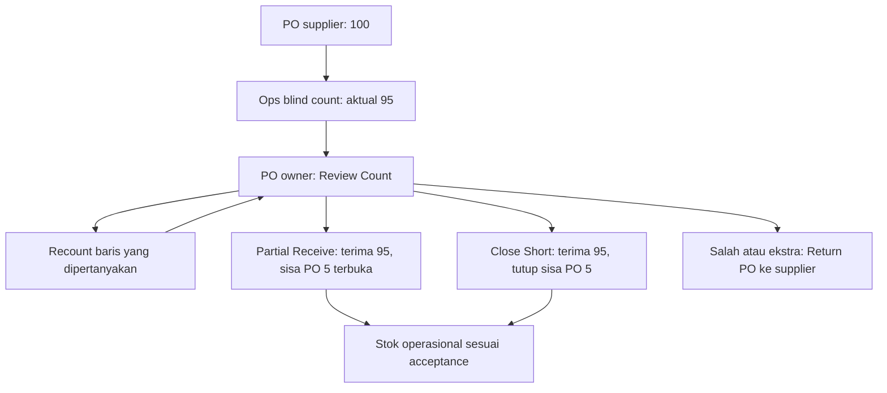
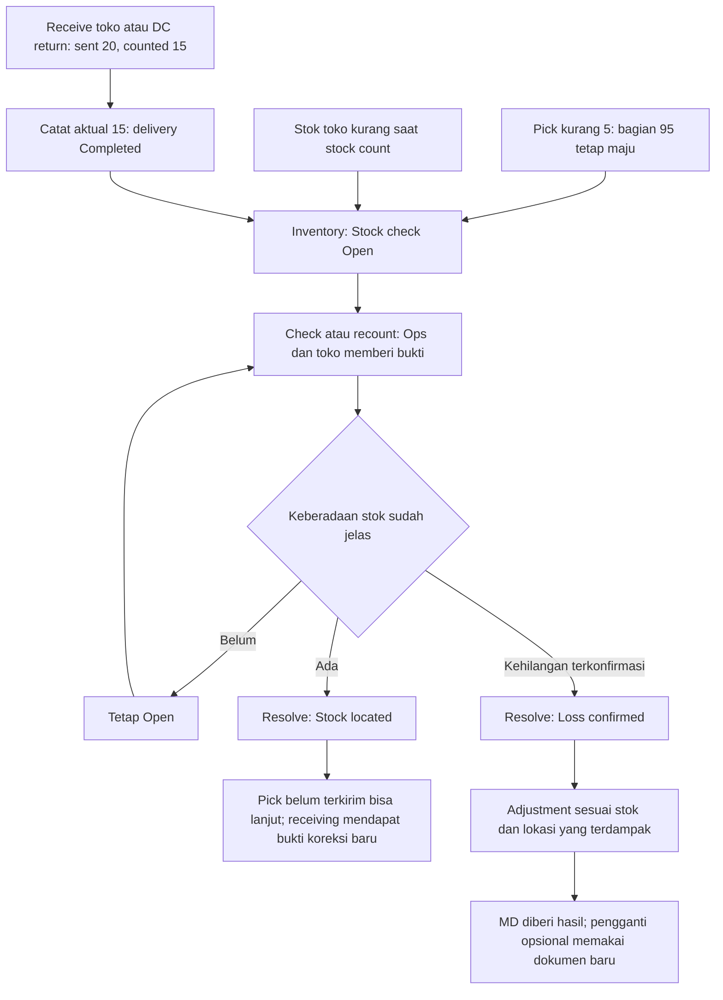
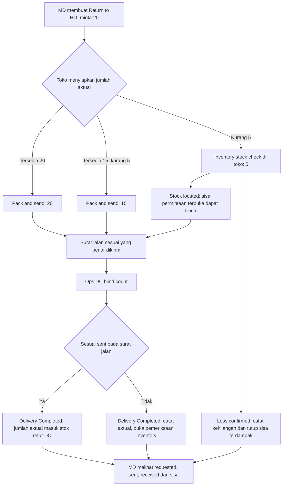

# Perbandingan PO, receiving toko, dan Return to HO

9 Oktober 2026. Review source; grafik target berdasarkan koreksi Hari. Tidak mengubah aplikasi atau melakukan build.

Peta lanjutan batas Edit, Recall sebelum acceptance, Move back, dan koreksi sesudah posting: [goods-flow-reversibility-map](2026-10-09-goods-flow-reversibility-map.md). Hari mengonfirmasi Recall adalah menarik count yang belum diterima reviewer.

## Keputusan terbaru dari chat

- MD cukup melihat informasi progres dan hasil; tanpa badge Needs action atau tugas pengganti wajib.
- Inventory: Open / Resolved. Tombol Resolve; hasil Stock located / Loss confirmed. Adjustment adalah dampak pencatatan stok, bukan sinonim Loss.
- Ops melaporkan jumlah aktual dan alasan kekurangan, tidak menetapkan Missing/Lost.
- Bagian yang tersedia tetap berjalan; sisa yang belum dikirim tetap di permintaan awal selama belum ditutup.
- Count selesai tidak ditahan karena investigasi. Delivery Completed; pemeriksaan dan fakta selisih ditampilkan terpisah.
- Tidak menimpa count asli atau membuka dokumen selesai. Replacement setelah kehilangan memakai dokumen baru jika MD memilihnya.

## 1. Yang ada pada PO sekarang

Source `frontend-hub/src/screens/procurement/count-review.tsx`:

- Ops submit blind count.
- Pemilik PO membuka Review Count. Hasil count diterima verbatim atau baris terpilih dikembalikan untuk Recount; alasan diperlukan untuk Recount.
- Jika kurang, tombol Partial Receive menerima yang datang dan membiarkan sisa PO terbuka. Close Short menerima yang datang dan menutup sisa secara eksplisit.
- Barang Not as Ordered dan berlebih masuk dokumen Return PO; code acceptance menerbitkan retur untuk baris tersebut. Tidak ada opsi keep pada code review saat ini, meskipun dokumen September masih mencatat pilihan ini sebagai keputusan terbuka.
- Stok operasional tercipta dari acceptance, bukan hanya menekan Submit count.

Ini pola UI yang dapat dipakai bersama: laporan/count → review bukti → terima hasil atau minta check/recount → simpan hasil. Pemilik dan efeknya mengikuti konteks; Inventory tidak menjadi gate penerimaan supplier sebelum acceptance.

Kurang 5 terhadap PO belum membuktikan perusahaan kehilangan 5 stok. Supplier mungkin baru mengirim sebagian. Jangan otomatis membuat Loss atau stock adjustment sebesar kekurangan PO.

## 2. Satu pola Inventory untuk stok perusahaan

Resolve tidak otomatis melakukan pick, mengirim barang, membuat allotment, atau menambah stok 5. Jumlah/lokasi dan bukti harus jelas. Koreksi stok/receiving dicatat sesuai fakta yang belum dibukukan; jangan menambahkan barang yang sudah dihitung atau mengurangi kehilangan yang sudah diposting untuk kedua kalinya.

| Konteks | Pembanding yang benar | Stock located | Loss confirmed |
|---|---|---|---|
| Pick target 100, picked 95 | Sisa pekerjaan 5 serta stok tercatat di lokasi; target pick bukan saldo seluruh rak | Ops dapat mengambil sisa 5 dari lokasi terverifikasi pada picklist yang masih terbuka | Catat kehilangan stok terverifikasi; sisa terdampak ditutup menurut aturan Lost, bagian 95 tetap berjalan; MD diberi hasil |
| Stok toko tercatat 20, aktual 15 | Saldo stok per SKU/lokasi pada saat count, dengan transaksi yang terjadi ikut diperiksa | Catat lokasi atau koreksi bukti; tidak menciptakan pengiriman baru | Adjustment stok toko untuk jumlah terverifikasi; tidak mengubah receipt lama yang dahulu diterima benar |
| Delivery ke toko: sent 20, counted 15 | Sent pada surat jalan aktual, per SKU | Bukti/correction baru mencatat tempat 5 ditemukan; count awal 15 tetap tersimpan | Kehilangan pada lokasi/custody berdasarkan bukti; tidak otomatis menjadi loss di toko hanya karena toko yang melapor |
| Return: toko sent 20, DC counted 15 | Sent pada surat jalan retur aktual, per SKU | Bukti baru dari DC, toko, atau transit; tidak mengulang booking 15 | Kehilangan ditetapkan berdasarkan bukti dan custody, MD diberi hasil retur |

Salah SKU dapat melibatkan dua pekerjaan: barang ekstra yang diketahui lokasinya untuk informasi/disposisi MD, SKU asli yang belum ditemukan untuk pemeriksaan Inventory. Jumlah total yang sama tidak membuktikan semua SKU sesuai. Barang salah tujuan yang lengkap dan jelas tidak wajib melewati pemeriksaan Inventory.

## 3. Return toko: permintaan, dikirim, diterima dipisahkan

Aturan yang masih berlaku: MD memulai Return to HO; toko menanggapi permintaan tersebut, tidak membuka retur baru sendiri. Toko tidak memerlukan board picking seperti DC.

Dua contoh yang berbeda:

1. Requested 20, sent 15, DC received 15: tidak ada kekurangan receiving. Yang kurang adalah sisa 5 sebelum dikirim, sehingga jika karena stok, diperiksa di toko. Permintaan return masih terbuka pada sisa 5 sampai terkirim atau resmi ditutup.
2. Requested 20, sent 20, DC received 15: selisih receiving 5. Inventory memeriksa dengan bukti packing toko, perjalanan, dan count DC. Tidak langsung menyalahkan toko atau mengubah sent menjadi 15.

Jika sisa terbuka ditemukan kemudian, pengiriman berikutnya memiliki surat jalan/receipt baru dan mengacu pada permintaan yang masih terbuka. Permintaan yang sudah ditutup tidak dihidupkan kembali.

## 4. Celah implementasi yang ditemukan

1. `frontend-store-new/src/screens/return-to-ho.tsx` sekarang hanya memiliki Pack and send untuk seluruh request. `frontend-store-new/src/lib/returns.ts` mengirim idempotency key tanpa jumlah aktual; `backend/src/edge/http.rs::store_return_send` mem-pick/pack seluruh `ask.lines[].quantity`. Usulan partial return di grafik belum didukung kontrak/UI tersebut.
2. Perlu input jumlah aktual per SKU saat send dan laporan alasan sisa, tanpa menambah board picking toko. Surat jalan harus berasal dari jumlah aktual yang dikirim.
3. `frontend-hub/src/screens/operations/intake/receive-return-sheet.tsx` sudah memiliki blind count → per-SKU comparison. Belum tampak tombol Request check/Resolve dan tautan kasus Inventory pada sheet tersebut.
4. CountReceive return sekarang menonaktifkan Submit count ketika tidak ada baris count; input qty 0 dihapus dari daftar. Kasus barang tiba/koli kosong tetapi receipt aktual 0 perlu representasi eksplisit, bukan dipaksa mengisi angka positif atau menganggap belum dihitung.
5. Saldo toko kurang tanpa shipment terkait, partial result (misalnya 3 ditemukan, 2 loss), serta salah SKU + kurang SKU asli perlu didukung oleh model kasus bersama.

Grafik ini usulan target. Flow PO dijelaskan dari source saat review; tidak mengklaim sudah diuji end-to-end atau seluruh flow sudah terimplementasi.
