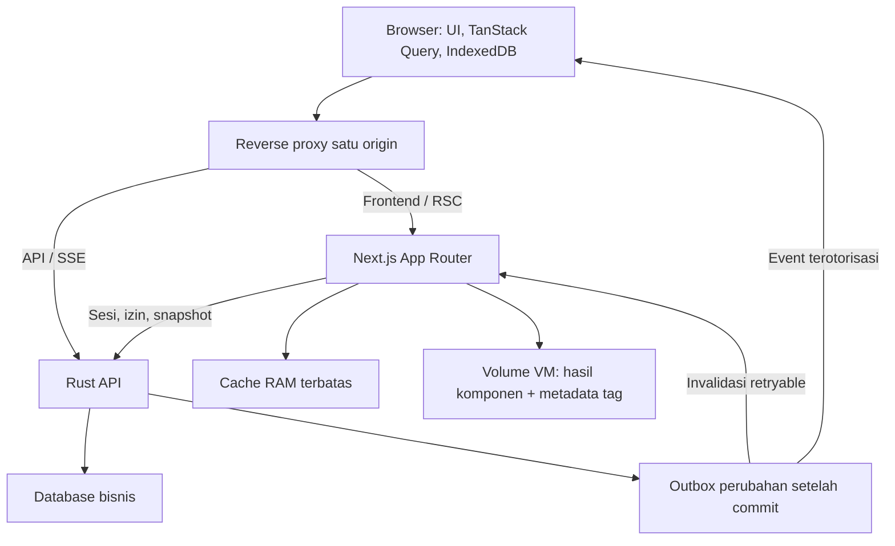

# Rancangan dan rencana uji Hub instan dengan Next.js + Rust

Status: rancangan siap dijadikan backlog implementasi; belum diimplementasikan atau diuji. Tanggal: 10 Oktober 2026. Pendamping: `nextjs-frontend-hub-20261010.md`.

## 1. Keputusan arsitektur

Gunakan Next.js App Router dengan Cache Components untuk prototype Hub, satu proses Node di VM yang sama/dekat dengan Rust. Rust tetap pemilik data, autentikasi, otorisasi, transaksi, dan agregasi. React/TanStack Query tetap pemilik interaksi dan update widget. Satu origin publik; reverse proxy membagi frontend, API Rust, dan edge. Tidak membutuhkan Redis untuk satu instance.

Target bukan memakai setiap fitur Next.js, melainkan menghindari pekerjaan berulang pada jalur yang terlihat pengguna. Jangan SSR seluruh ERP sekaligus. Prototype mencakup `/home`, ringkasan Sales, dan Sales Explorer dengan first page tabel serta navigasi di antaranya. Route asli ditentukan dari registry ketika implementasi; prefix eksperimen terisolasi dan feature flag memungkinkan rollback.

### Topologi



Path volume usulan `/var/lib/itulah/next-cache`, dikonfigurasi saat deployment, di luar direktori build dan bukan path yang ditulis dalam pekerjaan desain ini. RAM dan disk sama-sama cache yang dapat dibuang, bukan sumber data. Namespace hasil render mengikuti build ID sehingga deploy baru tidak menggunakan payload build lama.

## 2. Definisi kecepatan yang ingin dicapai

Angka berikut target acceptance prototype, bukan prediksi/hasil pengukuran. Referensi: laptop kantor modern, browser Chromium, production build, RTT browser ke VM 50 ms, koneksi 20 Mbps, CPU throttle 4x. Laporkan juga mesin tanpa throttle dan RTT 150 ms secara terpisah.

| Kondisi | Target p95 | Yang benar-benar diukur |
|---|---:|---|
| Navigasi yang sudah diprefetch / kembali ke halaman tersimpan | <=100 ms | Klik sampai data bermakna tampil |
| Reopen dengan aset dan data perangkat tersedia | <=500 ms | Navigation start sampai data tampil, setelah sesi sah |
| Direct open dengan cache VM tersedia, tanpa cache data perangkat | <=800 ms | Navigation start sampai ringkasan/first page tampil |
| Perangkat baru, cache VM tersedia | <=1.500 ms | Navigation start sampai data bermakna tampil |
| Input/filter/toggle lokal | <=100 ms | Input sampai frame respons; INP p75 <=200 ms |
| Perubahan yang sudah masuk event Rust | <=2 detik | Event diterima sampai widget sesuai version event |

Ukuran tambahan: direct warm first-page table bisa dipakai p95 <=1.200 ms; tidak boleh mengklaim kemenangan hanya karena angka terlihat tetapi tombol belum bekerja. Jika baseline sudah lebih cepat dari target, target bukan izin untuk menjadi lebih lambat.

Cache miss dan filter pertama yang belum pernah diminta dilaporkan tersendiri. Tidak menjanjikan data yang belum ada muncul dalam 100 ms. Target operasional kegagalan/isolasi tenant harus lulus seluruhnya.

## 3. Setiap lapisan dan pemiliknya

| Lapisan | Isi | Fungsi | Kebijakan |
|---|---|---|---|
| Aset HTTP/browser | CSS, font, JS hash | Tidak download ulang | Immutable untuk aset hash; manifest/dokumen strategi update |
| Shell Next.js | Struktur publik/netral | Paint tanpa menunggu query berat | Tidak berisi data pengguna/tenant pada build |
| Server Components | Komposisi halaman, ringkasan read-only, initial snapshot | HTML awal dan pengurangan kode client | Cache hanya subtree/fungsi yang sesuai |
| Cache VM Next.js | Hasil fungsi/komponen terpilih | Menghindari Rust read dan render ulang yang sama | RAM LRU + disk handler, tag/version, stale window |
| Router cache/prefetch | Payload route | Navigasi sebelum/ sesudah klik | Prefetch berprioritas, bukan semua menu |
| Activity | DOM/state route yang dipertahankan Next.js | Kembali tanpa kehilangan filter/scroll | Uji batas route dan lifecycle efek |
| TanStack Query | Data live per widget/query | Update sebagian, dedup fetch | Seed dari SSR, key sama dengan browser |
| IndexedDB | Snapshot allowlist data terakhir | Reopen dan offline terpilih | Pertahankan batas/isolasi Hub sekarang |

`use cache: private` dipakai hanya jika fungsi berbasis request memang perlu lifetime browser; bukan untuk disk persistence atau keputusan sesi permanen. `use cache: remote` tidak dibutuhkan sebelum beberapa instance atau bukti bahwa akses external store menguntungkan. `React.cache` hanya untuk dedup pekerjaan dalam request; bukan persistent cache.

## 4. Jalur pembukaan dan navigasi

### Direct open

1. Next mengirim shell netral cepat, membaca sesi dengan adapter request-scoped yang meneruskan cookie hanya ke Rust terpercaya. Sesi/izin dicabut harus tetap ditolak walau cache hangat.
2. Setelah Rust mengonfirmasi akses, bentuk context tenant/subject/permissionVersion/scope dan filter ternormalisasi.
3. Cache hit fresh: kembalikan snapshot/hasil komponen segera. Cache hit stale yang diizinkan: kembalikan hasil lama dan jadwalkan satu refresh. Hard expiry: jangan kembalikan hasil itu.
4. Render ringkasan dan first page saja. Bagian lambat seperti matrix/detail diletakkan pada Suspense terpisah, tidak menahan ringkasan.
5. SSR menyertakan seed QueryClient per request. Metadata snapshot mempertahankan usia asli data, bukan timestamp baru ketika payload dikirim.
6. Browser hydrate UI. Reconcile IndexedDB tanpa menimpa snapshot SSR yang lebih baru. Setelah context sah, ambil versi terbaru di background. Placeholder hanya untuk data yang memang belum pernah tersedia.

HTML saat request personal tidak di-cache sebagai respons publik CDN. Cached subtree tetap berada di belakang pemeriksaan akses request. HTTP HTML/RSC personal diberi kebijakan yang tidak menyebarkannya di shared proxy cache.

### Navigasi berikutnya

Prefetch hanya link intent serta 1-2 destinasi prioritas saat idle; maksimum dua request prefetch bersamaan untuk eksperimen. Hindari default viewport prefetch semua sidebar besar: gunakan adapter Link untuk menonaktifkan link nonprioritas dan mengaktifkan intent. Hormati Save-Data/jaringan buruk. Dedup dengan router/query; jangan prefetch Rust query yang sama lewat dua jalur tanpa manfaat.

Activity mempertahankan halaman yang dapat disimpan oleh Next.js; jangan mengganti key root ketika data berubah. Dialog transient ditutup saat halaman disembunyikan, draft/filter yang sengaja dipertahankan tetap ada. Subscriptions dan polling berhenti pada halaman tersembunyi; SSE koordinasi berada di provider tunggal.

### Reopen dan offline

Data persisten di perangkat hanya ditampilkan di bawah konteks identitas yang diverifikasi sesuai kebijakan Hub. Offline tidak boleh diklaim sebagai autentikasi baru dari snapshot. Fallback offline menggunakan shell client yang eksplisit dan kebijakan existing outbox; jangan caching semua HTML personal/RSC lewat service worker lama. Prototype online terlebih dahulu, lalu uji ulang use case offline sebelum rollout.

## 5. Penyimpanan cache VM

Bangun custom handler `cacheHandlers.default` mengikuti interface versi Next.js yang dikunci. Uji kontrak handler sebelum menghubungkannya dengan halaman. Jangan memakai API `cacheHandler` lama sebagai pengganti handler Cache Components.

- RAM LRU sebagai lapisan terdepan; anggaran awal 128 MiB dan disk 1 GiB untuk prototype, disesuaikan dengan RAM VM aktual.
- Disk menyimpan serialized entry bytes dan metadata timestamp/revalidate/expire/tags. Stream tidak boleh dibaca habis lalu digunakan ulang dalam keadaan consumed; setiap hit mendapat stream baru.
- Entry cap awal 2 MiB; subtree lebih besar tidak di-cache dan dicatat. Pekerjaan SSR tabel dipangkas ke first page, bukan menaikkan cap tanpa ukur.
- Tulis atomik dengan temporary file/rename atau storage transaksi yang sesuai; tidak menahan request hit untuk write disk. Key file berupa hash, bukan path yang dibangun dari input pengguna.
- Tag/version metadata harus durable bersama entry. Cache lama tidak boleh hidup lagi setelah restart karena tombstone invalidasi hilang.
- Singleflight per key untuk refresh, queue bounded, prioritas visible request di atas background warmup.
- Generation fence: jika invalidasi terjadi ketika render/fetch masih berjalan, hasil generation lama tidak diterbitkan sebagai fresh. Metadata invalidasi dipertahankan sampai semua entri terkait kedaluwarsa.
- Cache failure turun ke render/fetch biasa; jangan gagal login atau transaksi hanya karena disk penuh. Log/metric miss, stale hit, eviction, write failure, refresh error.
- Sebelum boot selesai: muat indeks/tag lalu izinkan hit; warm key umum setelah validasi context, bukan prewarm semua kombinasi user/filter.

Alasan handler custom: dokumentasi saat diperiksa menyebut default in-memory handler membuang entri saat revalidate, sehingga jangan mengasumsikan selalu melayani stale sampai expire. Disk handler harus membuktikan behavior SWR dalam uji kontraknya. [Cache handlers](https://nextjs.org/docs/app/api-reference/config/next-config-js/cacheHandlers).

## 6. Kunci, kesegaran, dan versi

Key logis: build/cacheSchema + tenant + subject/cakupan izin terverifikasi + permissionVersion + domain + canonical filters + page/pageSize/sort. Gunakan subject konservatif lebih dulu; berbagi antarpengguna hanya setelah audit cakupan akses. Jangan memakai cookie mentah sebagai key yang dicatat di log. Hindari context mutable global pada server.

Response snapshot usulan:

```ts
type Snapshot<T> = {
  data: T
  dataVersion: string
  generatedAt: string
  freshUntil: string
  staleUntil: string
  scopeVersion: string
}
```

Version domain harus monoton untuk scope terkait dan konsisten dengan transaksi sumber, bukan timestamp proses acak. Mekanisme exact di Rust ditentukan pada implementasi; `generatedAt` harus mewakili snapshot aktual. Ui menampilkan “diperbarui …” dan status refresh/error secara kecil tanpa menyembunyikan data valid.

| Kategori | Fresh target | Batas stale yang boleh ditampilkan | Setelah write |
|---|---:|---:|---|
| Ringkasan dashboard | 5 detik | 60 detik | Refetch query aktif |
| Explorer default | 15 detik | 5 menit | Invalidasi version domain terkait |
| Master read-only | 5 menit | 24 jam | Invalidasi domain |
| Status transaksi aktif | Request live atau <=2 detik | Tidak dipakai sebagai keputusan write | Jawaban Rust menjadi sumber |
| Sesi/izin | Validasi request | Tidak stale untuk otorisasi | Clear/purge context |

Angka adalah kebijakan usulan eksperimen, perlu disetujui berdasarkan semantik layar. Historical data tetap dapat berubah lewat backfill. Data melewati staleUntil tidak disajikan sebagai snapshot valid; tampilkan state menunggu atau state error yang jelas.

Profile Next untuk payload initial dashboard usulan `cacheLife({ stale: 30, revalidate: 5, expire: 60 })`; Explorer `{ stale: 30, revalidate: 15, expire: 300 }`. Interval update live tetap milik Query, bukan router. Jangan membaca `stale: 30` sebagai data harus menunggu 30 detik sebelum refresh. Nilai cacheLife mengatur mekanisme browser/server yang berbeda; konten umur pendek dapat menjadi dynamic hole, sehingga shell netral harus dipisah. [cacheLife](https://nextjs.org/docs/app/api-reference/functions/cacheLife).

Hit stale dari handler harus mempertahankan dataVersion/usia snapshot. Background render cache yang mengubah generatedAt tanpa data baru adalah bug. Prototype awal tidak menambah response cache Rust kedua: cache Next dan cache browser sudah cukup untuk eksperimen. Jika Rust response cache ditambahkan kemudian, TTL/generation dan invalidasinya harus terkoordinasi.

## 7. Invalidasi dan update layar

Transaksi Rust commit -> outbox durable perubahan domain -> worker retry -> invalidasi tag di Next dan event ke pengguna yang berhak. Event bukan isi transaksi personal; domain/version cukup untuk refetch terotorisasi. Outbox dipakai agar crash sesudah commit tidak kehilangan invalidasi; event coalesce untuk burst.

Untuk widget aktif: debounce/coalesce event, invalidate query terkait, fetch JSON langsung dari Rust, apply hanya versi lebih baru. Jangan menjalankan `router.refresh()` untuk setiap event. Satu angka hanya punya satu pemilik live; seed RSC tidak menjadi salinan angka independen yang tidak ikut berubah.

Untuk route RSC read-only: invalidasi tag server, lalu refresh route bila memang perlu. `router.refresh()` sendiri tidak menginvalidasi cache server. [useRouter](https://nextjs.org/docs/app/api-reference/functions/use-router).

Write dari browser: gunakan jawaban sukses Rust untuk update query atau refetch; jangan menunggu router stale window. `updateTag` khusus Server Actions; write langsung ke Rust tidak otomatis memanggilnya. Endpoint internal Next menerima invalidasi autentik dari Rust dan memetakan domain ke tag. TTL menjadi fallback ketika event gagal, bukan satu-satunya mekanisme read-your-own-writes.

Logout/tenant change/izin berubah: hentikan subscriptions, hapus query+IndexedDB terkait, hilangkan DOM personal yang dipertahankan, dan lakukan navigasi penuh bila dibutuhkan untuk memastikan router memory bersih. Uji revoke sesi ketika sebuah route tersembunyi kemudian muncul kembali.

## 8. UX dan batas rendering

- Jangan kosongkan tabel ketika background fetch. Pertahankan rows/layout dan beri indikator refresh kecil.
- Perubahan filter mempertahankan data sebelumnya hanya jika jelas berlabel “memuat hasil filter baru”; jangan menyajikan angka filter lama sebagai hasil filter baru.
- Render first page dan virtualisasi; jangan SSR ribuan rows/chart points. Dynamic import editor/export/chart berat yang tidak perlu first paint.
- Pastikan SSR markup dan client initial state konsisten; tanggal/locale/timezone bisnis tidak berbeda saat hydration.
- Optimistic UI hanya untuk operasi yang benar-benar bisa diprediksi dan dirollback. Posting finansial/stock final mengikuti hasil Rust.

## 9. Backlog implementasi dan exit criteria

### P0 — Baseline dan fixture

Instrumentasikan Hub sekarang tanpa mengubah perilaku. Simpan fixture deterministik yang sama untuk A/B. Tentukan route aktual home/Sales/Explorer, workload query, VM specs, concurrency referensi, dan freshness tiap widget. Output: traces/filmstrip, report browser+Rust, baseline p50/p95. 30 measured runs per kondisi single user setelah 5 warmups, cold runs reset cache yang tepat; traffic concurrency diuji terpisah.

### P1 — Prototype Next.js dan autentikasi

Buat aplikasi sibling eksperimen, pin versi stable yang diverifikasi saat implementasi, App Router + Cache Components + production build. Gunakan UI token/komponen yang ada dan adapter navigasi; jangan mount seluruh App CSR lalu menyebutnya SSR. Integrasikan request-scoped Rust identity, query seed, tiga route, shell/summary/first page Suspense. Exit: deep link, sesi/tenant, SSR HTML berisi data untuk context valid, hydration bersih, tidak double-fetch awal tanpa alasan.

### P2 — Browser navigation dan persistensi

Tambahkan intent/idle prefetch bounded, Query/IndexedDB reconcile, Activity lifecycle, metadata usia data, update JSON. Exit: kembali halaman mempertahankan scroll/filter/draft; restore tidak menimpa data baru; route eviction dan efek hidden benar; prefetch tidak memulai ratusan request.

### P3 — Cache VM durable

Implementasikan handler RAM+disk serta tag metadata, singleflight/generation fence dan metric. Uji fresh/stale/expired, concurrent miss, stream replay, restart, invalidasi saat render, disk penuh/corrupt, cap/eviction. Exit: stale hit tidak menunggu regenerasi; cache invalidated tidak kembali setelah restart; tidak ada cache lintas tenant/cakupan.

### P4 — Perubahan Rust dan konsistensi

Hubungkan outbox invalidasi, listener Next, dan event/refetch browser; implementasikan scope/domain versions. Exit: transaksi sendiri terlihat setelah sukses, perubahan POS/edge/backfill tercermin; retry event dan event out-of-order tidak menurunkan version; disconnect/reconnect melakukan catch-up.

### P5 — Pengujian deployment dan use case Hub

Jalankan pada VM eksperimen yang setara, satu origin, tanpa proxy buffering. Revalidasi headers assets/personal RSC, restart/deploy, concurrency 1/10/50 pengguna sebagai workload awal, CPU/memory/error serta hit rate. Integrasikan ulang offline fallback/outbox, SSE assistant, Tauri printing/downloads, tenant switching, logout lintas tab. Exit: semua use case wajib lulus; cache store bounded dan fallback sehat.

### P6 — Keputusan rollout

Bandingkan production A/B route yang sama. Untuk kondisi yang belum memenuhi target, prototype harus menunjukkan perbaikan p95 minimal 20% menuju target; kondisi yang sudah cepat tidak boleh regresi lebih dari 10%. Kebenaran data/izin dan offline wajib lulus tanpa toleransi kegagalan. Catat confidence/rentang, jangan menyimpulkan dari satu run. Rollout bertahap per route dengan rollback routing ke Hub lama. Full migration bukan bagian yang otomatis dijalankan setelah dokumen ini.

## 10. Matriks eksperimen dan hasil wajib

| Skenario | Cache yang disiapkan | Bukti |
|---|---|---|
| Perangkat baru, server miss | Browser kosong, VM kosong | Waktu data+interactive dan beban Rust |
| Perangkat baru, server hit | Browser kosong, VM fresh | Keuntungan SSR cache |
| Reopen | Aset+IDB valid, sesi valid | Restore/reconcile dan update terbaru |
| Stale server hit | Entry melewati fresh, sebelum expire | Data lama tampil sebelum refresh selesai |
| Hard expiry | Entry melewati expire | Tidak menyajikan stale tanpa batas |
| Prefetch hit dan miss | Intent selesai/belum | Click-to-data, jumlah request |
| Activity hit dan eviction | Kembali 1-3 route, lalu lebih | DOM/state dan heap memory |
| Filter belum pernah dipakai | Key baru | Feedback cepat, data benar, latensi query |
| Write sendiri / eksternal | Cache browser+VM hangat | Freshness end-to-end dan version |
| Revoke / tenant change | Semua cache hangat | Tidak menampilkan context lama |
| Restart / deploy | Volume tetap / build baru | Persistence sesuai namespace dan invalidasi |
| Event gagal / render race | Fault injection | Retry, fence, TTL fallback |
| Offline / koneksi putus | Shell+allowed data tersimpan | UX dan outbox sesuai kebijakan |

Setiap run merekam request count, bytes HTML/RSC/JS, server/cache timings, dataVersion, data-visible mark, first-interaction-ready mark, update-applied mark, long tasks, browser heap, VM RSS/CPU/disk, hit rate, serta p50/p95. Video/filmstrip memperlihatkan kapan data bermakna muncul. TTFB/skeleton cepat saja tidak cukup.

## 11. Risiko dan keputusan yang sengaja ditunda

Tidak membangun custom React renderer di Rust. Tidak memakai `use cache: remote` tanpa kebutuhan multi-instance. Tidak cache session validation sebagai hasil bisnis biasa. Tidak cache seluruh HTML personal di CDN. Tidak memindahkan semua interaksi ke Server Actions. Tidak melakukan full migration sebelum A/B.

Jika custom disk handler terlalu mahal atau tidak memenuhi target, ukur opsi simpler: Next default memory plus browser persistence, dengan cache miss/restart yang jujur; atau snapshot cache di Rust. Pilihan store dapat diganti, tetapi contract usia/version/isolasi tidak berubah. Tidak ada mekanisme yang menjamin direct open dari lokasi jauh selalu <100 ms karena RTT dan cold cache.

Rujukan tambahan: [Caching](https://nextjs.org/docs/app/getting-started/caching), [Authentication](https://nextjs.org/docs/app/guides/authentication-with-cache-components), [UI state](https://nextjs.org/docs/app/guides/preserving-ui-state), [Self-hosting](https://nextjs.org/docs/app/guides/self-hosting), [Revalidation](https://nextjs.org/docs/app/getting-started/revalidating).
